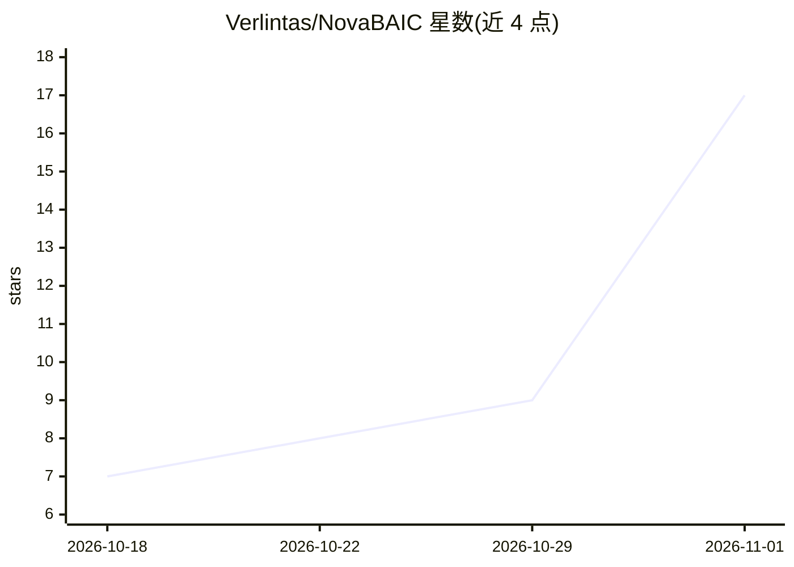

# Verlintas/NovaBAIC

⭐ 17 · Kotlin · GPL-3.0 · 推送 2026-10-31 · [GitHub](https://github.com/Verlintas/NovaBAIC) · [官网](https://verlintas.dev/NovaBAIC/) · 个人维护 · 中文 README

**本地优先的 Android AI 智能体 App：让 AI 通过函数调用操作手机**

BetterAIChat2（代号 Nova）是 BetterAIChat 的重制版，面向终端用户的 Android AI 智能体应用：提供 57 个设备工具（无障碍 UI 自动化、截屏 OCR、文件、网页、提醒、通知触发自动化、子代理与技能），通过函数调用让模型看屏、点击、输入、读写文件、跑定时自动化。仿生记忆系统含别名、时间线、来源出处、时间旅行检索与导出导入。支持 DeepSeek/OpenAI/Claude/Gemini/Kimi/Qwen/GLM/MiniMax 及任意 OpenAI 兼容端点（Ollama/vLLM/LM Studio）。无 GMS 依赖，API Key 经 Android Keystore 加密留在本地，无云端与遥测。以 APK 侧载安装（Android 8.0+），也可用 JDK 17 从源码构建。四种模式从纯聊天到带预算的自主运行；支持 MCP 远程工具。

## 筛选速览

| 维度 | 判定 | 备注 |
|---|---|---|
| AI 角色 | `ai-native` | 本体是模型或模型工具 |
| 许可风险 | `viral` | GPL-3.0 |
| 部署形态 | `None` |  |
| 模型依赖 | local-ok | 支持本地模型 |
| 硬件要求 | — | 无带数字的原话,不猜 |
| 安装摩擦 | `medium` | 含编译或系统依赖之一 |
| 成熟度 | — | 结构信号不足 |

## 能力要点

- 57 个内置设备工具：无障碍自动化、截屏 OCR、文件、网页、个人助理
- 仿生记忆：别名、情景检索、出处、时间旅行、隐私保留与导出导入
- 四种模式（Chat/Chat+/Act/Max），Max 支持预算约束的自主运行与后台执行
- 不锁定模型：多家服务商及任意 OpenAI 兼容端点，API Key 本地 Keystore 加密

## 适用场景

- 用对话让 AI 操作手机：打开 App、发消息、读屏幕、整理文件
- 定时或通知触发的无人值守自动化任务
- 跨会话记住个人信息的本地 AI 助手，数据不出设备
- 接入自有 Ollama/vLLM 本地模型端点在手机上使用

## 场景标签

`AI 助手` `GUI 自动化` `Agent 记忆` `OCR` · 领域:Agent 开发

## 证据(README 行号)

> L23: 它是**本地优先**的 AI 智能体 —— API Key 经 Android Keystore 加密留在设备上，没有云端、没有遥测、不需要账号；AI 通过**函数调用**真实操作你的手机：看屏、点击、输入、读写文件、设置提醒、跑
> L25: - **真操作设备**：57 个内置工具，覆盖无障碍操作、截屏 OCR、文件、网络、个人助理、内置无线调试与 Shizuku shell
> L88: - **仿生记忆**：常驻核心记忆（关于你 / 正在进行，占用恒定，可被 `core_memory_update` 当场纠正）+ 跨会话情景检索（`memory_search` / `memory_read`，按说话人加权、支持实

## 星数曲线

2026-10-18 7 → 2026-11-01 17（+10）

---
*卡片 v1 · prompt 1.4 · 生成 2026-10-31 · 置信度 high · 依据 README sha `0a1173941230` · [字段定义](../../DATASET.md)*
