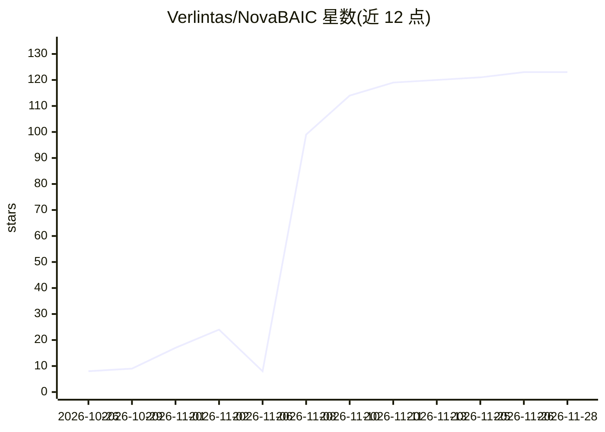

# Verlintas/NovaBAIC

⭐ 123 · Kotlin · GPL-3.0 · 推送 2026-11-11 · [GitHub](https://github.com/Verlintas/NovaBAIC) · [官网](https://verlintas.dev/NovaBAIC/) · 个人维护 · 中文 README

**本地优先的 Android AI 智能体：让 AI 通过工具真实操作设备**

BetterAIChat2（代号 Nova）是一款本地优先的 Android AI 智能体应用：API Key 经 Android Keystore 加密留在设备上，无云端、无遥测、无需账号，AI 通过函数调用真实操作手机（截屏 OCR、无障碍 UI 自动化、文件读写、网络、提醒、通知触发自动化）。内置 58 个工具、Chat/Chat+/Act/Max 四种运行模式、子代理、MCP 远程工具与 YAML 技能；仿生记忆系统支持别名、来源出处、时间旅行检索与导出/导入。要求 Android 8.0+，无 GMS 依赖；APK 侧载安装，源码可用 Gradle 构建（JDK 17 + Android SDK）。

## 筛选速览

| 维度 | 判定 | 备注 |
|---|---|---|
| AI 角色 | `ai-native` | 本体是模型或模型工具 |
| 许可风险 | `viral` | GPL-3.0 |
| 部署形态 | `None` |  |
| 模型依赖 | local-ok | 支持本地模型 |
| 硬件要求 | — | 无带数字的原话,不猜 |
| 安装摩擦 | `medium` | 含编译或系统依赖之一 |
| 成熟度 | — | 结构信号不足 |

## 能力要点

- 58 个内置设备工具：截屏 OCR、无障碍 UI 自动化、文件、网络、个人助理、Shizuku shell
- Chat/Chat+/Act/Max 四种运行模式，可配置工具权限、逐次确认与运行预算
- 仿生记忆：常驻核心记忆、跨会话检索、别名、来源出处、时间旅行、导出/导入
- 支持 OpenAI 兼容、Anthropic Messages、Gemini 协议及 Ollama/vLLM/LM Studio 等本地端点

## 适用场景

- 让 AI 在无 GMS 的 Android 设备上代为操作应用（看屏、点击、输入）
- 配置定时任务让 AI 每天自动汇报天气和日程
- 在本地保存全部对话与记忆数据，不经过云端
- 接入 Ollama/vLLM 等本地模型端点运行智能体

## 场景标签

`AI 助手` `Agent 记忆` `OCR` `GUI 自动化` · 领域:Agent 开发

## 证据(README 行号)

> L23: 它是**本地优先**的 AI 智能体 —— API Key 经 Android Keystore 加密留在设备上，没有云端、没有遥测、不需要账号；AI 通过**函数调用**真实操作你的手机：看屏、点击、输入、读写文件、设置提醒、跑
> L29: - **不锁定模型**：DeepSeek / OpenAI / Claude / Gemini / Kimi / Qwen / GLM / MiniMax / Ollama / 任意兼容网关，随时切换
> L31: - **无人值守**：定时任务、前台服务、子代理、MCP 远程工具、Skills 技能

## 星数曲线

2026-10-26 8 → 2026-11-28 123（+115）

---
*卡片 v1 · prompt 1.4 · 生成 2026-11-28 · 置信度 high · 依据 README sha `8c1f8cf0873b` · [字段定义](../../DATASET.md)*
