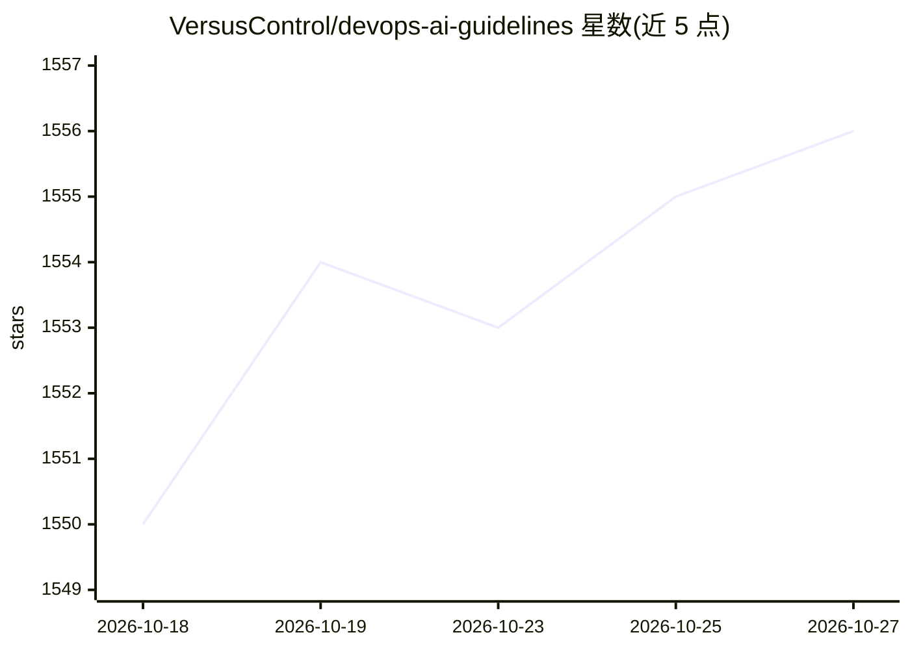

# VersusControl/devops-ai-guidelines

⭐ 1,556 · Python · MIT · 推送 2026-09-24 · [GitHub](https://github.com/VersusControl/devops-ai-guidelines) · [官网](https://versusincident.com) · 组织维护

**DevOps 工程师的 AI 学习路径与企业落地指南合集**

面向 DevOps 工程师、团队负责人与组织管理者的 AI 学习与落地资源仓库：提供 18 个月从 DevOps 工程师到 AI 基础设施架构师的学习路线、MCP 服务器与 AI Agent 构建（Golang、LangChain、Kubernetes）教程、SRE 监控 Agent 与运维知识库方案、团队 AI 安全实施框架、面试与日常提示词集及 AWS 认证加速资源。内容以文档形式组织，分个人、团队、组织三类快速入门路径，由 Versus Incident 赞助、DevOps VN 社区维护，MIT 许可。

## 筛选速览

| 维度 | 判定 | 备注 |
|---|---|---|
| AI 角色 | `ai-knowledge` | 知识聚合/清单类 |
| 许可风险 | `permissive` | MIT |
| 部署形态 | `None` |  |
| 模型依赖 | — | README 未给出锁定关系 |
| 硬件要求 | — | 无带数字的原话,不猜 |
| 安装摩擦 | `low` | 无编译、无系统依赖或容器化 |
| 成熟度 | — | 结构信号不足 |

## 能力要点

- 18 个月分三阶段的 AI 基础设施架构师学习路线
- Golang 构建 MCP 服务器与 AI Agent 的教程
- 团队级 AI 安全实施框架（15-20 分钟阅读）
- 10 个 DevOps 日常 AI 提示词与 AWS 认证加速资源

## 适用场景

- 按路线图系统学习 DevOps 方向的 AI 技能
- 为团队制定 AI 安全使用规范与实施框架
- 准备 AI 相关的 DevOps 面试与 AWS 认证
- 参考 Golang 构建 MCP 服务器和 AI Agent 的做法

## 场景标签

`教程课程` `精选清单` · 领域:学习与行业

## 证据(README 行号)

> L13: - **Complete learning roadmap** from DevOps to AI Infrastructure Architect
> L24: **Complete 18-month journey from DevOps Engineer to AI Infrastructure Architect**
> L39: |**AI Guidelines for DevOps Teams**|Complete framework for implementing AI safely in your organization|15-20 min|

## 星数曲线

2026-10-18 1,550 → 2026-10-27 1,556（+6）

---
*卡片 v1 · prompt 1.4 · 生成 2026-10-21 · 置信度 high · 依据 README sha `ec5f72cdba3f` · [字段定义](../../DATASET.md)*
