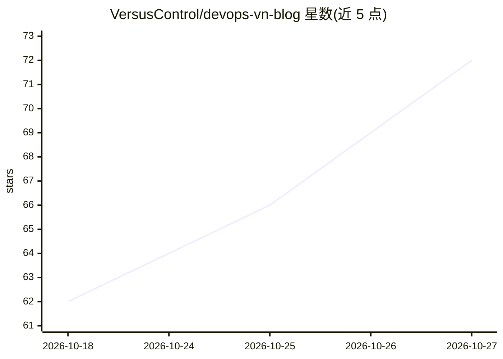

# VersusControl/devops-vn-blog

⭐ 72 · HCL · 推送 2026-10-01 · [GitHub](https://github.com/VersusControl/devops-vn-blog) · [官网](https://devopsvn.tech) · 组织维护

**分享 DevOps 与云计算知识的博客网站（Jekyll）**

由 VersusControl 维护、Versus Incident 赞助的 Jekyll 静态博客，内容围绕 DevOps 与云计算（Terraform、Kubernetes、AWS、Azure、Prometheus、Linux 等标签）。README 主要面向投稿者：说明 fork/分支/提交 PR 的贡献流程、文章需放入 _articles/ 目录并附带 front matter、图片存放路径与标签规范，用 bundle exec jekyll build/serve 本地构建预览，合并 main 后自动部署。

## 筛选速览

| 维度 | 判定 | 备注 |
|---|---|---|
| AI 角色 | `ai-knowledge` | 知识聚合/清单类 |
| 许可风险 | `none` | — |
| 部署形态 | `None` |  |
| 模型依赖 | — | README 未给出锁定关系 |
| 硬件要求 | — | 无带数字的原话,不猜 |
| 安装摩擦 | `low` | 无编译、无系统依赖或容器化 |
| 成熟度 | — | 结构信号不足 |

## 能力要点

- Jekyll 驱动的 DevOps/云计算知识博客
- _articles/ 目录以 Markdown + front matter 组织文章
- 提供完整的 fork→分支→PR 贡献流程文档
- 本地构建/预览命令（bundle exec jekyll build/serve）

## 适用场景

- 阅读 DevOps 与云计算相关的系列文章与译文
- 翻译或撰写文章并向站点投稿
- 参考其贡献流程了解如何参与开源内容项目

## 场景标签

`教程课程` · 领域:学习与行业

## 证据(README 行号)

> L3: DevOps VN is a website that shares knowledge about DevOps and Cloud Computing.
> L45: 1. Create a new Markdown file in `_articles/` using a descriptive kebab-case

## 星数曲线

2026-10-18 62 → 2026-10-27 72（+10）

---
*卡片 v1 · prompt 1.4 · 生成 2026-10-24 · 置信度 high · 依据 README sha `d37a9dc15f4a` · [字段定义](../../DATASET.md)*
