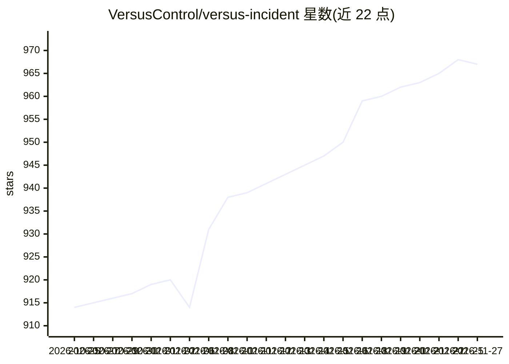

# VersusControl/versus-incident

⭐ 967 · Go · MIT · 推送 2026-11-26 · [GitHub](https://github.com/VersusControl/versus-incident) · [官网](https://versusincident.com) · 组织维护

**自托管 AI SRE 代理：自动检测事件并升级 on-call**

以只读方式接入 Kubernetes 与日志/指标/追踪的运维事件处理系统，提供三种问题发现路径：只读扫描集群并检测异常工作负载、以训练模式学习日志正常模式后在检测模式开启事件、接收既有告警工具的 webhook 并按模板分发与升级。支持 Slack/Teams/Telegram 等通知渠道、PagerDuty 等升级通道、Go 模板与 PostgreSQL 存储；部分能力（指标/追踪源、告警降噪、SSO、高可用）标注为 Enterprise。MIT 许可，以 Helm/Kubernetes 部署，文档在 docs.versusincident.com。

## 筛选速览

| 维度 | 判定 | 备注 |
|---|---|---|
| AI 角色 | `ai-enhanced` | 去掉 AI 部分产品仍成立 |
| 许可风险 | `permissive` | MIT |
| 部署形态 | `None` |  |
| 模型依赖 | — | README 未给出锁定关系 |
| 硬件要求 | — | 无带数字的原话,不猜 |
| 安装摩擦 | `low` | 无编译、无系统依赖或容器化 |
| 成熟度 | — | 结构信号不足 |

## 能力要点

- 只读接入 Kubernetes，自动检测异常工作负载并关联日志与变更时间线
- AI SRE Agent 先在训练模式学习日志模式，检测模式发现新错误即开启事件
- Webhook 接入 Alertmanager/Grafana/Sentry 等工具，支持模板分发与 on-call 升级
- 通知渠道覆盖 Slack、Teams、Telegram、Email、Lark 等，升级通道含 PagerDuty/ServiceNow

## 适用场景

- 无人值守时自动升级未确认的告警给值班工程师
- 在 Kubernetes 集群中自动发现 CrashLoopBackOff 等异常工作负载
- 把现有 Alertmanager/Grafana 告警统一格式化分发到多个渠道
- 在 Versus UI 中以对话方式查询系统问题并引用只读证据

## 场景标签

`工作流自动化` `聊天机器人` · 领域:效率与自动化

## 证据(README 行号)

> L6:  Your AI SRE Teammate
> L27: 3. **Webhook alerts.** The alert tools you already run (Alertmanager, Grafana,
> L50: Point the agent at your logs and let it learn your normal patterns in training

## 星数曲线

2026-10-25 914 → 2026-11-27 967（+53）

---
*卡片 v1 · prompt 1.4 · 生成 2026-11-24 · 置信度 mid · 依据 README sha `7381f1ec63ff` · [字段定义](../../DATASET.md)*
