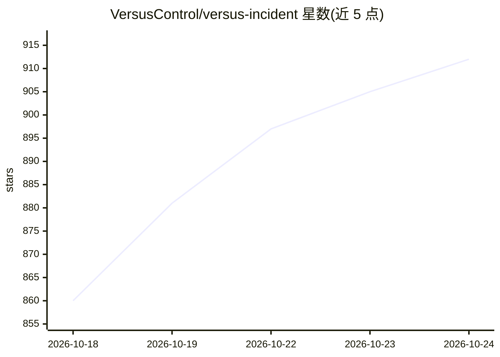

# VersusControl/versus-incident

⭐ 914 · Go · MIT · 推送 2026-10-23 · [GitHub](https://github.com/VersusControl/versus-incident) · [官网](https://versusincident.com) · 组织维护

**自托管的 AI SRE 事件代理：自动检测系统异常并分发告警**

自托带的 DevOps 事件管理服务：一方面提供 AI SRE 代理，读取日志、指标、追踪与 Kubernetes 状态，学习正常模式，对未见过的新错误自动创建事件并生成摘要、严重级别与建议步骤；另一方面接收来自 Alertmanager、Grafana、Sentry、CloudWatch SNS、FluentBit 等工具的 webhook 告警。事件经 Go 模板渲染后分发到 Slack/Teams/Telegram 等多渠道，未确认时升级到 On-Call（AWS Incident Manager/PagerDuty）。以 Docker 镜像和 Helm Chart 部署，AI 代理启用时需 Redis；代理有 training/shadow/detect 三种渐进模式。

## 筛选速览

| 维度 | 判定 | 备注 |
|---|---|---|
| AI 角色 | `ai-enhanced` | 去掉 AI 部分产品仍成立 |
| 许可风险 | `permissive` | MIT |
| 部署形态 | `self-host` | docker 或自建部署 |
| 模型依赖 | — | README 未给出锁定关系 |
| 硬件要求 | — | 无带数字的原话,不猜 |
| 安装摩擦 | `low` | 无编译、无系统依赖或容器化 |
| 成熟度 | — | 结构信号不足 |

## 能力要点

- AI SRE 代理学习日志模式并对新异常自动创建事件（training/shadow/detect 三模式）
- 接收 Alertmanager/Grafana/Sentry/CloudWatch SNS/FluentBit 等 webhook 告警
- 多渠道通知（Slack/Teams/Telegram/Viber/Email/Lark）与 On-Call 升级（PagerDuty/AWS Incident Manager 等）
- Kubernetes Harness 仪表盘与 Go 模板自定义告警消息

## 适用场景

- 让 AI 代理盯日志，出现新错误时自动告警，免维护告警规则
- 把现有监控工具的告警统一汇聚到同一套通知与 On-Call 流程
- 在 Kubernetes 环境中集中查看集群健康、工作负载与 Helm/GitOps 状态

## 场景标签

`工作流自动化` · 领域:效率与自动化

## 证据(README 行号)

> L22: - **AI SRE Agent (auto-detect)** — point the agent at your logs, metrics, traces, and kubernetes, then it learns yo
> L29: - 🤖 **AI SRE Agent**: An AI agent that reads your logs, metrics and traces, learns what normal looks like, and auto
> L35: - 🌐 **Webhook Alerts**: Receive incidents from any tool that can POST a webhook — Alertmanager, Grafana, Sentry, Cl

## 星数曲线

2026-10-18 860 → 2026-10-24 912（+52）

---
*卡片 v1 · prompt 1.4 · 生成 2026-10-21 · 置信度 high · 依据 README sha `ecb44f1b4404` · [字段定义](../../DATASET.md)*
