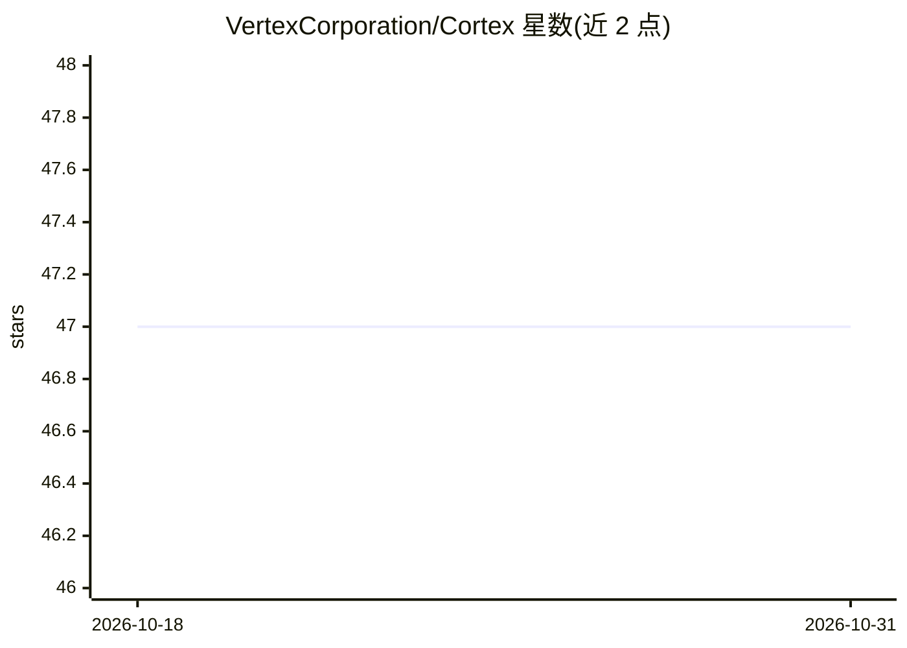

# VertexCorporation/Cortex

⭐ 47 · Dart · Apache-2.0 · 推送 2026-10-26 · [GitHub](https://github.com/VertexCorporation/Cortex) · [官网](https://vertexishere.com) · 组织维护

**混合 AI 平台：移动端本地推理+多供应商编排+检索记忆**

Cortex 是三层架构的混合 AI 平台：客户端运行时（对话、上下文组装、RAG、语义记忆、PII 处理、离线推理）、Fulcrum 执行面（认证、路由、SSE 流式、多供应商回退、计费与权益）、Synapse 控制面（多源模型目录摄取、去重、版本化与发布）。本地推理通过 llama.cpp 以 JNI/NDK 原生绑定在移动端执行 GGUF 模型，云端可接入 OpenRouter、Groq、Cloudflare Workers AI 等多种供应商。README 描述其支撑一个覆盖 190+ 国家的消费级移动产品，仓库本身主要呈现架构文档，安装说明在源码部分。

## 筛选速览

| 维度 | 判定 | 备注 |
|---|---|---|
| AI 角色 | `ai-native` | 本体是模型或模型工具 |
| 许可风险 | `permissive` | Apache-2.0 |
| 部署形态 | `None` |  |
| 模型依赖 | local-ok | 支持本地模型 |
| 硬件要求 | — | 无带数字的原话,不猜 |
| 安装摩擦 | `medium` | 含编译或系统依赖之一 |
| 成熟度 | — | 结构信号不足 |

## 能力要点

- llama.cpp 原生绑定在移动端本地执行 GGUF 模型
- 本地检索/记忆/PII 处理与云端执行共用同一会话模型
- 能力感知的动态路由、SSE 流式与供应商回退
- Synapse 模型控制面：多源摄取、去重、人工策展与自动同步分离

## 适用场景

- 在移动设备上离线运行 GGUF 模型对话
- 用一个客户端统一访问多家文本/媒体/语音/转录供应商
- 构建带计费与权益管理的消费级 AI 产品

## 场景标签

`RAG` `推理引擎` `模型网关` · 领域:Agent 开发

## 证据(README 行号)

> L25: |**Cortex**|Client runtime|UI state, conversations, local persistence, context assembly, RAG, memory, PII handling,
> L105: Cortex supports local model execution through `llama.cpp`, integrated into the mobile runtime through native bindi
> L360: Cortex exposes the underlying platform through a mobile interface built around conversations, multimodal creation,

## 星数曲线

2026-10-18 47 → 2026-10-31 47（+0）

---
*卡片 v1 · prompt 1.4 · 生成 2026-10-25 · 置信度 mid · 依据 README sha `834df6262f5d` · [字段定义](../../DATASET.md)*
