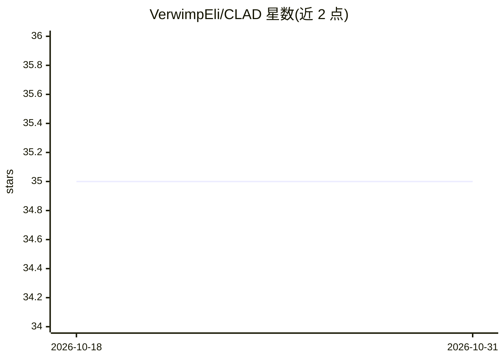

# VerwimpEli/CLAD

⭐ 35 · Python · 推送 2026-05-27 · [GitHub](https://github.com/VerwimpEli/CLAD) · 组织维护

**自动驾驶持续学习基准：分类与检测两条评测赛道**

基于 SODA10M 数据集构建的持续学习基准，提供 CLAD-C（在线分类流，含时序相关的分布偏移）与 CLAD-D（域增量目标检测，四任务）两条赛道。以 Python 模块形式提供，仅依赖 PyTorch/torchvision，可选接入 Avalanche 0.2.0 与 Detectron2；附评测指标（AMCA、平均 mAP@0.5）、挑战规则与最小示例，并要求训练时不得访问过去数据。

## 筛选速览

| 维度 | 判定 | 备注 |
|---|---|---|
| AI 角色 | `ai-knowledge` | 知识聚合/清单类 |
| 许可风险 | `none` | — |
| 部署形态 | `library` | 以包/库形式分发 |
| 模型依赖 | — | README 未给出锁定关系 |
| 硬件要求 | — | 无带数字的原话,不猜 |
| 安装摩擦 | `medium` | 含编译或系统依赖之一 |
| 成熟度 | — | 结构信号不足 |

## 能力要点

- CLAD-C：时序图像流上的在线分类基准，含自然分布偏移
- CLAD-D：按天气/场景划分四任务的域增量检测基准
- 提供纯 PyTorch、Avalanche、Detectron2 三种实现路径
- 定义 AMCA 与平均 mAP 评测指标及挑战规则

## 适用场景

- 评测持续学习方法在真实分布偏移下的表现
- 域增量目标检测方法研究
- 复现或参与 CLAD 基准挑战实验

## 场景标签

`模型评测` · 领域:评测与运维

## 证据(README 行号)

> L7: Welcome to the official repository for the CLAD benchmark. The goal of CLAD is to introduce a more realistic testing
> L9: autonomous driving to create two benchmarks. CLAD-C is an online classification benchmark with natural, temporal
> L10: correlated and continuous distribution shifts. CLAD-D is a domain incremental continual object detection benchmark.

## 星数曲线

2026-10-18 35 → 2026-10-31 35（+0）

---
*卡片 v1 · prompt 1.4 · 生成 2026-10-25 · 置信度 mid · 依据 README sha `abec26184330` · [字段定义](../../DATASET.md)*
