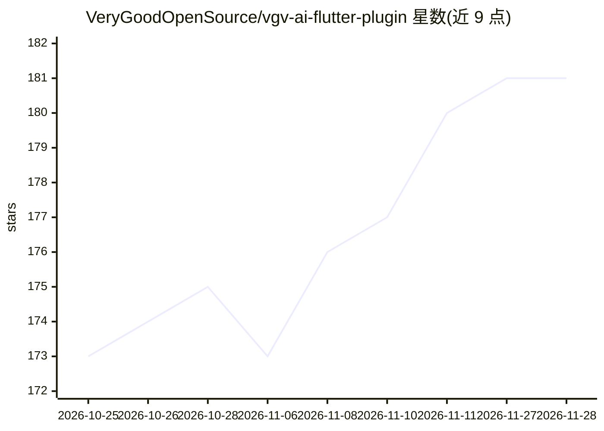

# VeryGoodOpenSource/vgv-ai-flutter-plugin

⭐ 181 · Shell · MIT · 推送 2026-11-26 · [GitHub](https://github.com/VeryGoodOpenSource/vgv-ai-flutter-plugin) · 组织维护

**为 Flutter/Dart 开发提供最佳实践技能的 Claude Code 插件**

由 Very Good Ventures 构建的 Claude Code 插件，将 Flutter 与 Dart 开发的最佳实践封装为技能（skills），同时包含 agents、hooks 与 MCP 工具。插件本体位于 plugin/ 目录，即用户安装的部分；仓库另含基于 claude plugin eval 的评测套件与贡献指南，说明如何添加、修改和本地测试技能。具体技能清单与安装方式在 plugin/ 的 README 中给出。

## 筛选速览

| 维度 | 判定 | 备注 |
|---|---|---|
| AI 角色 | `ai-ecosystem` | LLM/agent 周边工具 |
| 许可风险 | `permissive` | MIT |
| 部署形态 | `None` |  |
| 模型依赖 | — | README 未给出锁定关系 |
| 硬件要求 | — | 无带数字的原话,不猜 |
| 安装摩擦 | `low` | 无编译、无系统依赖或容器化 |
| 成熟度 | — | 结构信号不足 |

## 能力要点

- 以 Claude Code 插件形式分发 Flutter/Dart 最佳实践技能
- 包含 skills、agents、hooks 与 MCP 工具
- 提供 claude plugin eval 评测套件（evals/）
- 贡献文档覆盖技能的新增与本地测试

## 适用场景

- 在 Claude Code 中为 Flutter/Dart 项目加载 VGV 最佳实践技能
- 团队内统一 Flutter 状态管理、i18n 等实践约定
- 为自有 Claude Code 插件开发提供结构参考

## 场景标签

`编码 Agent` `提示工程` · 领域:Agent 开发

## 证据(README 行号)

> L5: A [Claude Code][claude_code_link] plugin that accelerates Flutter & Dart development with best-practices skills from
> L7: The plugin lives in `plugin/`. Its README covers installation, skills, agents, hooks and MCP tools.

## 星数曲线

2026-10-25 173 → 2026-11-28 181（+8）

---
*卡片 v1 · prompt 1.4 · 生成 2026-11-27 · 置信度 mid · 依据 README sha `4dae44249dae` · [字段定义](../../DATASET.md)*
