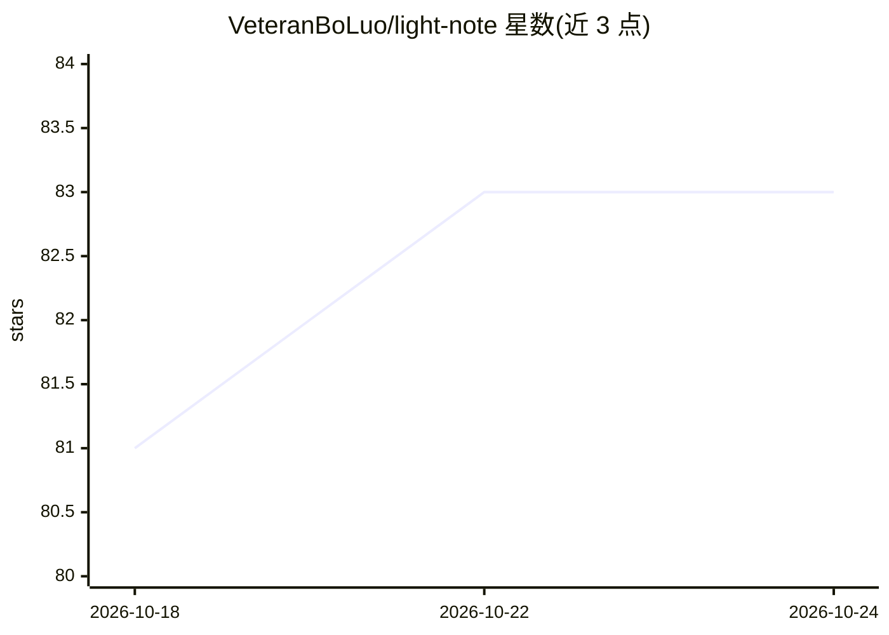

# VeteranBoLuo/light-note

⭐ 83 · JavaScript · MIT · 推送 2026-10-24 · [GitHub](https://github.com/VeteranBoLuo/light-note) · [官网](https://boluo66.top) · 个人维护 · 中文 README

**免费在线书签/笔记/待办/云文件管理平台，内置模块 AI**

面向个人用户的多合一资料管理 Web 服务：书签自动抓取、富文本与 Markdown 笔记、云文件存储、待办管理，统一标签与全局跨模块搜索串联资料，账号体系下跨设备同步。AI 为各模块内范围明确的能力（对当前资源做总结、生成、拆解、整理）。定位为在线服务，浏览器注册即用；仓库开放源码（MIT），自行部署需自备数据库、对象存储、缓存、邮件及第三方 AI 服务，无一键自托管方案。AI 与云空间有额度限制。

## 筛选速览

| 维度 | 判定 | 备注 |
|---|---|---|
| AI 角色 | `ai-enhanced` | 去掉 AI 部分产品仍成立 |
| 许可风险 | `permissive` | MIT |
| 部署形态 | `None` |  |
| 模型依赖 | — | README 未给出锁定关系 |
| 硬件要求 | — | 无带数字的原话,不猜 |
| 安装摩擦 | `low` | 无编译、无系统依赖或容器化 |
| 成熟度 | — | 结构信号不足 |

## 能力要点

- 书签/笔记/云文件/待办四模块统一账号管理与跨设备同步
- 统一标签体系与跨模块全局搜索
- 各模块内基于当前资源的 AI 总结、生成、拆解与整理
- 多语言界面与移动端适配

## 适用场景

- 把散落的书签、笔记、文件和待办集中到一个账号管理
- 用标签和全局搜索快速找回收藏的资料
- 让 AI 对笔记、文件等当前资源做总结和整理

## 场景标签

`知识库管理` · 领域:知识与检索

## 证据(README 行号)

> L8:  免费的书签、笔记、待办与云文件管理平台
> L65: **🤖 模块 AI**

## 星数曲线

2026-10-18 81 → 2026-10-24 83（+2）

---
*卡片 v1 · prompt 1.4 · 生成 2026-10-24 · 置信度 high · 依据 README sha `6456b1555e55` · [字段定义](../../DATASET.md)*
