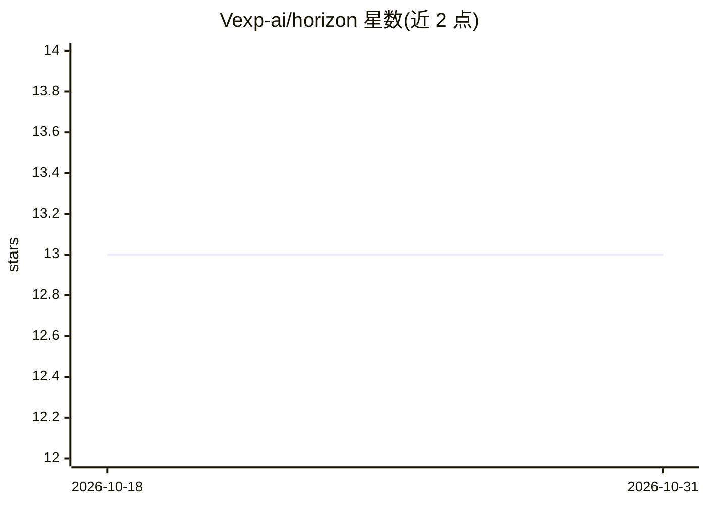

# Vexp-ai/horizon

⭐ 13 · Python · MIT · 推送 2026-07-06 · [GitHub](https://github.com/Vexp-ai/horizon) · 组织维护

**让 16GB 本地小模型做可验证代码/数学的验证层研究项目**

研究项目：在开源权重模型外包裹一层验证优先的执行框架——元认知路由器、沙箱测试执行、符号数学校验（Math-Verify）、best-of-N 选择与代码代理修复循环，每条回答附带测试证据。训练无关、可换底座，宣称在可验证任务上让 7B 接近其 671B 教师模型（限定于可验证任务，非通用编码）。支持 llama.cpp CPU（Q4_K_M）与 vLLM GPU 两档推理，提供预注册复制协议与逐题结果 JSON。面向能运行 Python 实验环境的研究者/开发者，限英文 README、MIT 许可。

## 筛选速览

| 维度 | 判定 | 备注 |
|---|---|---|
| AI 角色 | `ai-ecosystem` | LLM/agent 周边工具 |
| 许可风险 | `permissive` | MIT |
| 部署形态 | `library` | 以包/库形式分发 |
| 模型依赖 | local-ok | 支持本地模型 |
| 硬件要求 | — | 无带数字的原话,不猜 |
| 安装摩擦 | `low` | 无编译、无系统依赖或容器化 |
| 成熟度 | — | 结构信号不足 |

## 能力要点

- 硬验证器（沙箱测试执行 + Math-Verify）拥有最终裁决权，神经裁判默认关闭
- 代码代理修复循环：冻结测试→失败反馈→重试，预算不超过 best-of-N
- 底座无关：冻结 harness 换底座（Qwen3-8B/Ministral-8B）预注册复测
- CPU 下限路径：llama.cpp Q4_K_M，16GB 机器 RSS ≤8GB，投机解码 drafter 为 Qwen2.5-0.5B

## 适用场景

- 在消费级机器上离线运行带测试验证的代码生成
- 研究验证层对本地小模型能力的提升幅度
- 复现预注册的跨底座成对基准实验

## 场景标签

`代码生成` `模型评测` · 领域:编码与开发

## 证据(README 行号)

> L8: and coding system: **a metacognitive router + an execution harness with hard
> L9: verifiers** (sandboxed test execution, symbolic math checking), best-of-N
> L161: - **Hard verifiers hold final authority**: sandboxed execution for code,
> L175: serve/     vLLM (GPU tier) + llama.cpp (CPU floor) router/    heuristics + v0 embedding + v1 classifier

## 星数曲线

2026-10-18 13 → 2026-10-31 13（+0）

---
*卡片 v1 · prompt 1.4 · 生成 2026-10-31 · 置信度 high · 依据 README sha `2a31fbee1c0e` · [字段定义](../../DATASET.md)*
