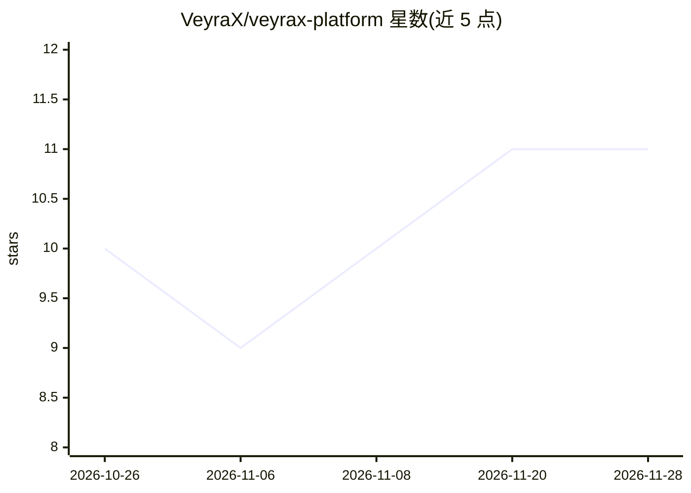

# VeyraX/veyrax-platform

⭐ 11 · Python · MIT · 推送 2026-10-12 · [GitHub](https://github.com/VeyraX/veyrax-platform) · 组织维护

**为 AI Agent 提供统一工具调用、OAuth、MCP 与记忆的基础设施层**

VeyraX 是连接 AI Agent 与外部工具的基础设施层：单个 API key 让 Agent（Claude、Cursor 或自建 LLM 应用）经统一接口（/tools、/tool-call/{tool}/{method}）访问 83 个集成与数千个 MCP 服务器，并附带长期记忆与自然语言定义的多步 Flow。凭证以 AES 加密存储并代用户注入调用；工具与 provider 建有向量索引支持语义检索；集成返回结构化 component.json 由前端渲染。后端 FastAPI、前端 Next.js 14，依赖 Supabase/Redis/Qdrant/OpenRouter，提供 Docker 一键启动脚本。

## 筛选速览

| 维度 | 判定 | 备注 |
|---|---|---|
| AI 角色 | `ai-ecosystem` | LLM/agent 周边工具 |
| 许可风险 | `permissive` | MIT |
| 部署形态 | `self-host` | docker 或自建部署 |
| 模型依赖 | locked-api |  |
| 硬件要求 | — | 无带数字的原话,不猜 |
| 安装摩擦 | `low` | 无编译、无系统依赖或容器化 |
| 成熟度 | — | 结构信号不足 |

## 能力要点

- 单个 API key 统一访问 83 个集成与数千个 MCP 服务器
- OAuth 凭证管理：AES 加密存储并代用户注入工具调用
- 一键部署任意 GitHub 托管的 MCP 服务器（Dockerfile 生成、GitHub Actions 构建、推送 Docker Hub）
- 自然语言描述转多步 agent 工作流，支持按需或定时运行

## 适用场景

- 让 Agent 通过统一接口调用 Gmail、Slack、Notion 等日常工具
- 自建 LLM 应用时免去逐个集成的 OAuth 与凭证管理
- 将 GitHub 上的 MCP 服务器快速部署为 Docker 镜像
- 把重复性操作流程固化为可调度的 agent 工作流

## 场景标签

`Agent 记忆` `工作流自动化` · 领域:Agent 开发

## 证据(README 行号)

> L21: VeyraX is an infrastructure layer that connects AI agents to the tools people actually use.
> L41: - **Tool calling API** — a single, uniform interface (`/tools`, `/tool-call/{tool}/{method}`) over 80+
> L71: |`aci_server/`|Python backend: FastAPI app, integrations, agent runtime (OpenAI Agents SDK / OpenRouter), flows, me

## 星数曲线

2026-10-26 10 → 2026-11-28 11（+1）

---
*卡片 v1 · prompt 1.4 · 生成 2026-11-20 · 置信度 mid · 依据 README sha `2648da4a7270` · [字段定义](../../DATASET.md)*
