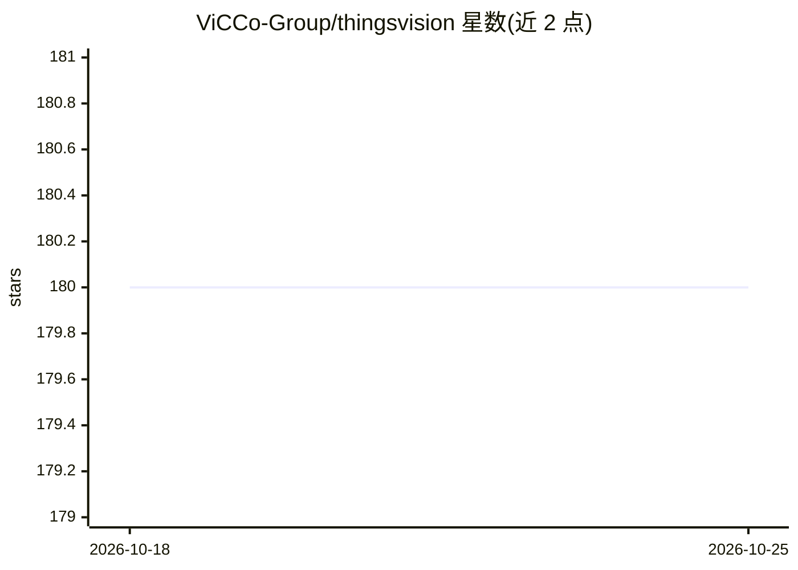

# ViCCo-Group/thingsvision

⭐ 180 · Python · MIT · 推送 2025-11-12 · [GitHub](https://github.com/ViCCo-Group/thingsvision) · [官网](https://vicco-group.github.io/thingsvision/) · 组织维护

**从计算机视觉模型中提取图像表征的 Python 工具箱，面向认知科学研究者**

Python 包 thingsvision，提供从多种计算机视觉模型（torchvision、Keras、timm、自监督模型、CLIP/OpenCLIP、CORnet、SAM 等）提取图像表征（特征图）的功能：用户指定图像目录与网络模块，即可获得每张图一个向量或矩阵形式的特征，供进一步分析使用。附加功能包括将特征与人类物体相似度对齐（gLocal）、RSA、CKA 比较、直接读取 HDF5 数据集及对 THINGS 图像数据库（>26,000 图）提特征。提供 CLI 与 Python API，支持 PyTorch 与 TensorFlow/Keras。限制：原论文中部分函数调用已弃用，需按 README 与文档使用。由马普所人类认知与脑科学研究所与柏林工业大学机器学习组联合维护，附 2021 年论文。

## 筛选速览

| 维度 | 判定 | 备注 |
|---|---|---|
| AI 角色 | `ai-native` | 本体是模型或模型工具 |
| 许可风险 | `permissive` | MIT |
| 部署形态 | `library` | 以包/库形式分发 |
| 模型依赖 | — | README 未给出锁定关系 |
| 硬件要求 | — | 无带数字的原话,不猜 |
| 安装摩擦 | `medium` | 含编译或系统依赖之一 |
| 成熟度 | — | 结构信号不足 |

## 能力要点

- 从 torchvision/Keras/timm/自监督/CLIP/OpenCLIP/CORnet/SAM 等多种来源模型提取特征
- 特征与人类物体感知对齐（gLocal）、RSA 与 CKA 分析
- 支持 THINGS 图像数据库（>26,000 图）与 HDF5 数据集（如 NSD stimuli）
- 提供 CLI（show-model / extract-features）与 Python API，支持 PyTorch 与 TensorFlow/Keras

## 适用场景

- 对自有图像集批量提取深度网络各层激活用于分析
- 比较不同模型表征与人类物体相似度判断的 alignment
- 跨模型-模块组合做 CKA/RSA 表征相似性分析

## 场景标签

`图像视频处理` `科研工具` · 领域:学习与行业

## 证据(README 行号)

> L34: `thingsvision` is a Python package for extracting (image) representations from many state-of-the-art computer visio
> L42: - extract features for any imageset from many popular networks.
> L231: This is a joint open-source project between the Max Planck Institute for Human Cognitive and Brain Sciences, Leipz

## 星数曲线

2026-10-18 180 → 2026-10-25 180（+0）

---
*卡片 v1 · prompt 1.4 · 生成 2026-10-22 · 置信度 high · 依据 README sha `eba2a8303e3d` · [字段定义](../../DATASET.md)*
