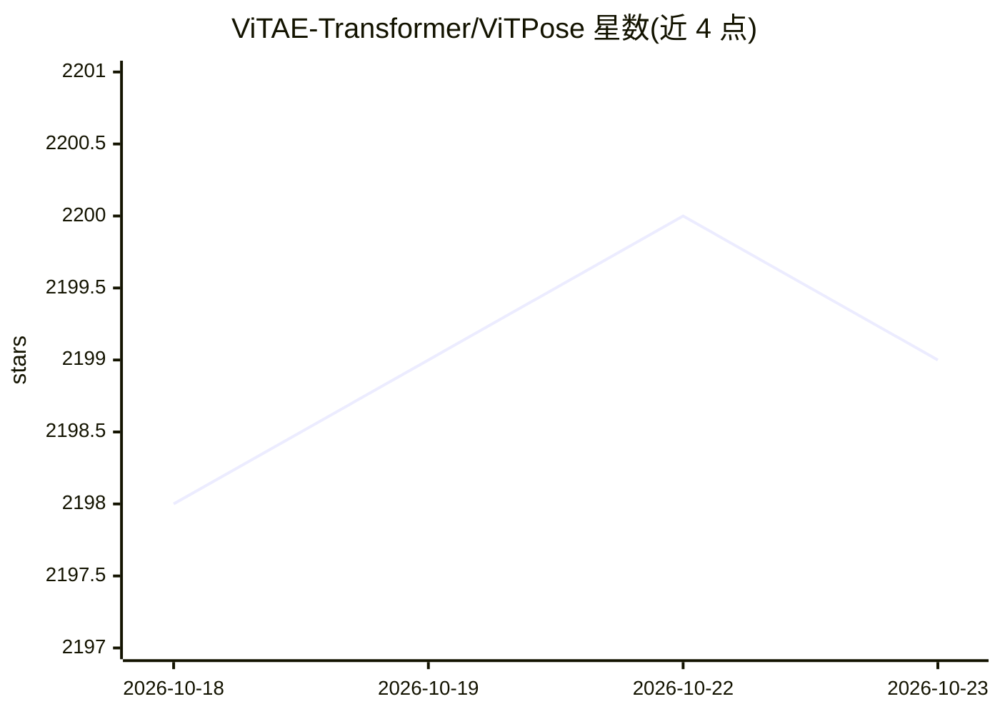

# ViTAE-Transformer/ViTPose

⭐ 2,199 · Python · Apache-2.0 · 推送 2025-12-25 · [GitHub](https://github.com/ViTAE-Transformer/ViTPose) · 组织维护

**ViT 人体/动物姿态估计模型库：训练评测与预训练权重**

NeurIPS'22 ViTPose 与 TPAMI'23 ViTPose++ 的 PyTorch 官方实现，面向姿态估计研究者与开发者。提供 ViTPose-S/B/L/H/G 多规模模型，基于 MAE 预训练，覆盖人体（COCO/AIC/MPII/CrowdPose/OCHuman）、动物（AP10K/APT36K）、WholeBody 与手部（InterHand2.6M）数据集的训练配置、日志与权重下载；ViTPose++ 用 MoE 策略联合处理多任务。依赖 mmcv、timm、einops，通过分布式脚本训练与测试，并提供 Hugging Face Spaces 的图像与视频 Web Demo。

## 筛选速览

| 维度 | 判定 | 备注 |
|---|---|---|
| AI 角色 | `ai-native` | 本体是模型或模型工具 |
| 许可风险 | `permissive` | Apache-2.0 |
| 部署形态 | `library` | 以包/库形式分发 |
| 模型依赖 | — | README 未给出锁定关系 |
| 硬件要求 | — | 无带数字的原话,不猜 |
| 安装摩擦 | `low` | 无编译、无系统依赖或容器化 |
| 成熟度 | — | 结构信号不足 |

## 能力要点

- 提供 S/B/L/H/G 多规模 ViTPose 及 ViTPose++ 预训练权重与配置
- 覆盖人体、动物、WholeBody、手部多数据集评测结果
- ViTPose++ 采用 MoE 策略联合处理人体/动物/全身姿态任务
- Gradio Web Demo 集成于 Hugging Face Spaces

## 适用场景

- 在 COCO 等数据集上训练或微调姿态估计模型
- 下载预训练权重进行姿态估计推理与评测
- 复现论文中各模型规模的实验结果

## 场景标签

`微调` · 领域:训练与推理

## 证据(README 行号)

> L16: This branch contains the pytorch implementation of ViTPose: Simple Vision Transformer Baselines for Human Pose Esti
> L176: > [2023-01-10] Update ViTPose++! It uses MoE strategies to jointly deal with human, animal, and wholebody pose est

## 星数曲线

2026-10-18 2,198 → 2026-10-23 2,199（+1）

---
*卡片 v1 · prompt 1.4 · 生成 2026-10-21 · 置信度 mid · 依据 README sha `d1fe74de8f84` · [字段定义](../../DATASET.md)*
