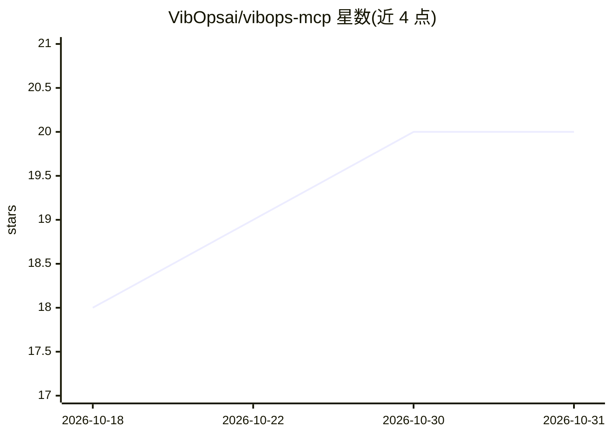

# VibOpsai/vibops-mcp

⭐ 20 · Python · MIT · 推送 2026-10-30 · [GitHub](https://github.com/VibOpsai/vibops-mcp) · [官网](https://vibops.ai) · 组织维护

**MCP 服务器：让 AI 助手操作 GPU 基础设施与 Agent FinOps**

vibops-mcp 是连接 AI 助手与 VibOps 平台的 MCP 服务器，通过 pip 安装后可从 Claude Desktop、Cursor 等 MCP 客户端调用 117 个工具：部署模型与 Helm/kubectl 操作、管理 Proxmox/vSphere/Xen Orchestra/HPE VME 虚拟机、GPU 监控与异常处置、按 Agent 记账与预算强制（软告警 80%/硬阻断 100%）、合规报告与不可变审计链。所有操作经 VibOps 实例执行并记录；另含 OpenAI 兼容 LLM 推理代理（vLLM/Ollama/TGI）按 Agent 归因成本。需配置 VIBOPS_URL 与 API Token。

## 筛选速览

| 维度 | 判定 | 备注 |
|---|---|---|
| AI 角色 | `ai-ecosystem` | LLM/agent 周边工具 |
| 许可风险 | `permissive` | MIT |
| 部署形态 | `library` | 以包/库形式分发 |
| 模型依赖 | local-ok | 支持本地模型 |
| 硬件要求 | — | 无带数字的原话,不猜 |
| 安装摩擦 | `low` | 无编译、无系统依赖或容器化 |
| 成熟度 | — | 结构信号不足 |

## 能力要点

- 117 个 MCP 工具覆盖部署、运维、治理与 FinOps
- 按 Agent 的成本追踪、预算强制与模型访问规则
- 跨 Proxmox/vSphere/XO/HPE VME 的虚拟机管理（含迁移与快照）
- OpenAI 兼容代理（端口 8004）为推理请求记录 Agent 归因

## 适用场景

- 在对话中部署和扩缩 GPU 集群上的模型与 K8s 工作负载
- 追踪各 AI Agent 的 GPU/LLM 成本并执行预算限制
- 跨多套虚拟化平台管理虚拟机与迁移
- 生成 SOC 2/RGPD/HIPAA 合规报告并审计操作记录

## 场景标签

`模型网关` `MLOps` · 领域:Agent 开发

## 证据(README 行号)

> L16: `vibops-mcp` connects your AI assistant to VibOps — the engine that clones, builds, deploys, scales, monitors, fixe
> L49: `vibops-mcp` speaks the Model Context Protocol, so the same server entry works

## 星数曲线

2026-10-18 18 → 2026-10-31 20（+2）

---
*卡片 v1 · prompt 1.4 · 生成 2026-10-28 · 置信度 high · 依据 README sha `c72d5e93ec38` · [字段定义](../../DATASET.md)*
