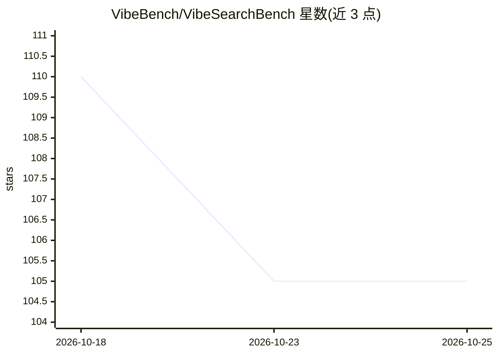

# VibeBench/VibeSearchBench

⭐ 105 · Python · MIT · 推送 2026-05-28 · [GitHub](https://github.com/VibeBench/VibeSearchBench) · [官网](https://vibebench.github.io/VibeSearchBench.github.io/) · 组织维护

**多轮主动搜索 agent 评测基准：200 长程任务，三元组 F1 评分**

面向搜索型 agent 的评测基准：包含 200 个跨 20 个领域的长程任务，分为专业研究（pro）与日常生活（daily）两个子集各 100 题；任务采用角色扮演的用户模拟器进行渐进式信息透露的多轮交互，agent 可搜索、访问网页与运行代码。评分机制为 schema-free 知识图谱评测：先由 LLM-as-judge 做节点对齐，再判定三元组语义等价，输出节点与三元组级 Precision/Recall/F1（avg@N、best@N）。提供 GeneralAgent 与 OpenClaw 两种接入方式和仅评测脚本，数据集托管于 Hugging Face。

## 筛选速览

| 维度 | 判定 | 备注 |
|---|---|---|
| AI 角色 | `ai-ecosystem` | LLM/agent 周边工具 |
| 许可风险 | `permissive` | MIT |
| 部署形态 | `None` |  |
| 模型依赖 | local-ok | 支持本地模型 |
| 硬件要求 | — | 无带数字的原话,不猜 |
| 安装摩擦 | `low` | 无编译、无系统依赖或容器化 |
| 成熟度 | — | 结构信号不足 |

## 能力要点

- 200 任务、2 子集（pro/daily）、20 领域
- 角色驱动渐进式透露的多轮交互模拟
- schema-free 知识图谱评测，主指标为 Triplet F1
- 支持单 agent 与多 agent（可派生子 agent）两种模式

## 适用场景

- 评测搜索 agent 在模糊多轮查询下的表现
- 对比不同模型/agent 框架的检索研究能力
- 复用两阶段 LLM-as-judge 评测流程给自己的轨迹打分

## 场景标签

`模型评测` · 领域:评测与运维

## 证据(README 行号)

> L23: * **Primary metric: Triplet F1.** Predicted knowledge graphs are matched against ground truth via LLM-as-judge node
> L29: 200 tasks across 2 subsets and 20 domains. Each task pairs a vague initial query with a ground-truth knowledge grap
> L151: Two-phase LLM-as-judge evaluation:

## 星数曲线

2026-10-18 110 → 2026-10-25 105（-5）

---
*卡片 v1 · prompt 1.4 · 生成 2026-10-23 · 置信度 high · 依据 README sha `6b48a2f6e7aa` · [字段定义](../../DATASET.md)*
