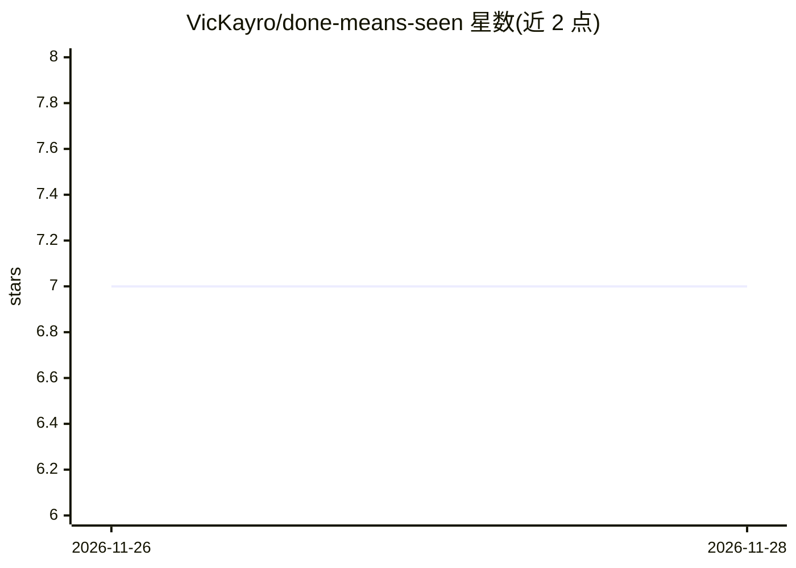

# VicKayro/done-means-seen

⭐ 7 · Python · MIT · 推送 2026-11-25 · [GitHub](https://github.com/VicKayro/done-means-seen) · 个人维护

**给 Claude Code 加完成校验：测试不过就打回去继续干**

以 Claude Code Stop hook 形式运行的验证工具：当模型即将结束回合时，读取会话记录、定位其写入的文件，按 verify.json 中各项目配置运行 typecheck/测试等 static 命令，失败则以退出码 2 阻止回合结束并把错误回传给模型。附带四条写入 CLAUDE.md 的验证规则，以及 Andon：记录 agent 问题的登记表，同一问题复发时拒绝同级修复并强制升级为代码级护栏。零依赖，Python 3.9+，MIT 许可。

## 筛选速览

| 维度 | 判定 | 备注 |
|---|---|---|
| AI 角色 | `ai-ecosystem` | LLM/agent 周边工具 |
| 许可风险 | `permissive` | MIT |
| 部署形态 | `library` | 以包/库形式分发 |
| 模型依赖 | locked-api |  |
| 硬件要求 | — | 无带数字的原话,不猜 |
| 安装摩擦 | `low` | 无编译、无系统依赖或容器化 |
| 成熟度 | — | 结构信号不足 |

## 能力要点

- Stop hook 自动重跑 typecheck 与测试，失败即阻止回合结束
- 已验证状态（同 commit 同 diff）跳过，每请求最多 3 次阻止防死循环
- Andon 登记表：问题复发时拒绝同等级修复，强制升级为机制/标准级
- 安装器写入 ~/.claude 并备份，hook 默认关闭，支持会话回放试运行

## 适用场景

- 让 Claude Code 写完代码后自动通过类型检查和测试才算完成
- 免去人工反复粘贴报错信息回喂 agent 的流程
- 记录并追踪 agent 反复出问题的根因与修复是否有效

## 场景标签

`编码 Agent` · 领域:编码与开发

## 证据(README 行号)

> L10:  Claude Code Stop hook
> L61: Claude Code runs Stop hooks when the model is about to end its turn. `verify_on_stop.py`:
> L86: Every complaint about one of your agents gets logged with its cause and its fix. If the same problem comes back, th

## 星数曲线

2026-11-26 7 → 2026-11-28 7（+0）

---
*卡片 v1 · prompt 1.4 · 生成 2026-11-26 · 置信度 mid · 依据 README sha `c5a2ea548e5d` · [字段定义](../../DATASET.md)*
