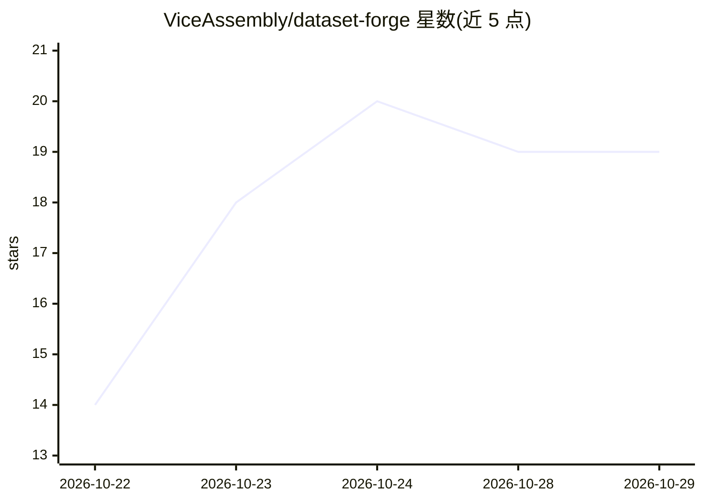

# ViceAssembly/dataset-forge

⭐ 19 · C# · MIT · 推送 2026-10-18 · [GitHub](https://github.com/ViceAssembly/dataset-forge) · 个人维护

**Windows 上为 LoRA 训练准备图像数据集的便携工具**

面向 Windows 10/11 x64 的开源数据集构建工具：一键生成 kohya 训练器期望的按概念分文件夹目录树（含 repeat 命名），提供批量 .txt 标注编辑网格（查找替换、触发词注入）、感知哈希近重复图像去重、分辨率分桶预览与 zip 导出。以约 100 MB 自包含便携 exe 分发，离线运行，无广告无遥测，CI 构建并发布 SHA-256 校验。也可用 .NET 8 SDK 从源码构建。

## 筛选速览

| 维度 | 判定 | 备注 |
|---|---|---|
| AI 角色 | `ai-ecosystem` | LLM/agent 周边工具 |
| 许可风险 | `permissive` | MIT |
| 部署形态 | `None` |  |
| 模型依赖 | — | README 未给出锁定关系 |
| 硬件要求 | — | 无带数字的原话,不猜 |
| 安装摩擦 | `medium` | 含编译或系统依赖之一 |
| 成熟度 | — | 结构信号不足 |

## 能力要点

- 一键生成 kohya 目录树（1_concept repeat 命名）
- 批量标注编辑：网格、查找替换、触发词统一注入
- 感知哈希近重复图像去重与分桶预览
- 约 100 MB 自包含便携 exe，离线运行，SHA-256 校验发布

## 适用场景

- 在训练 LoRA 前整理图像文件夹结构与重复样本
- 批量修正数千条 .txt 标注并统一触发词
- 训练前预览图像将落入的分辨率分桶

## 场景标签

`图像视频处理` · 领域:感知与多模态

## 证据(README 行号)

> L3: 🏗️ Free, open-source dataset builder for Windows — kohya folder layout, bulk captions, dedupe and bucketing. 100 MB 
> L11: - ✅ **Kohya layout in one click** — folder-per-concept tree with the 1_concept repeat naming trainers expect
> L42: Training guides jump straight to the trainer, but most failed runs trace back to folder layout, duplicate images an

## 星数曲线

2026-10-22 14 → 2026-10-29 19（+5）

---
*卡片 v1 · prompt 1.4 · 生成 2026-10-28 · 置信度 high · 依据 README sha `988b5b149167` · [字段定义](../../DATASET.md)*
