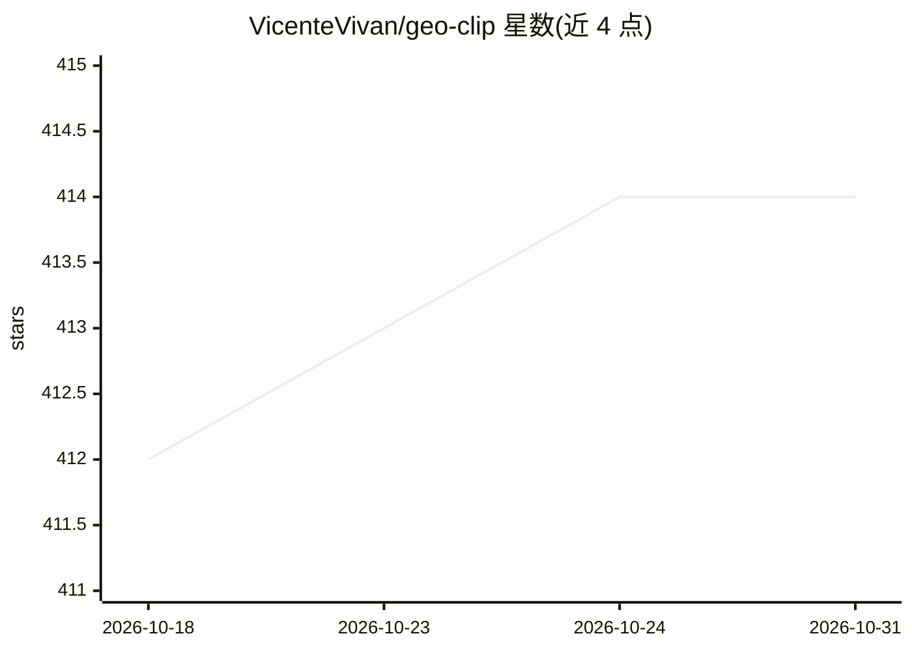

# VicenteVivan/geo-clip

⭐ 414 · Python · MIT · 推送 2026-10-25 · [GitHub](https://github.com/VicenteVivan/geo-clip) · [官网](https://arxiv.org/abs/2309.16020) · 组织维护

**图像全球地理定位模型：将图像与 GPS 坐标对齐预测拍摄位置**

NeurIPS 2023 论文 GeoCLIP 的官方 PyTorch 实现。借鉴 CLIP 对比学习，用 470 万张全球图像-GPS 配对数据（MP-16）训练，将图像与地理位置对齐，实现全球图像地理定位，并可将位置编码器用作预训练 GPS 编码器，辅助其他地理感知神经网络（如 GPS-only 多分类，在 Geo-Tagged NUS-Wide 上报告结果）。面向科研与开发者，pip 安装即用，提供 Colab 演示与推理代码示例；基准数据集包括 Im2GPS3k、YFCC26k、GWS15k 等。

## 筛选速览

| 维度 | 判定 | 备注 |
|---|---|---|
| AI 角色 | `ai-native` | 本体是模型或模型工具 |
| 许可风险 | `permissive` | MIT |
| 部署形态 | `library` | 以包/库形式分发 |
| 模型依赖 | — | README 未给出锁定关系 |
| 硬件要求 | — | 无带数字的原话,不猜 |
| 安装摩擦 | `low` | 无编译、无系统依赖或容器化 |
| 成熟度 | — | 结构信号不足 |

## 能力要点

- CLIP 式对比训练实现图像与 GPS 坐标对齐的全球地理定位
- 预训练位置编码器可作为 GPS 特征提取器用于其他架构
- 在 Im2GPS3k/YFCC26k/GWS15k/NUS-Wide 基准上报告结果
- pip 安装并提供 Colab 演示

## 适用场景

- 给定照片预测其拍摄的 GPS 位置
- 为地理感知模型提取 GPS 嵌入特征
- 复现论文中的地理定位与 GPS 分类实验

## 场景标签

 · 领域:计算机视觉/地理定位

## 证据(README 行号)

> L12: GeoCLIP addresses the challenges of worldwide image geo-localization by introducing a novel CLIP-inspired approach 
> L18: Similarly to OpenAI's CLIP, GeoCLIP is trained contrastively by matching Image-GPS pairs. By using the MP-16 datase

## 星数曲线

2026-10-18 412 → 2026-10-31 414（+2）

---
*卡片 v1 · prompt 1.4 · 生成 2026-10-21 · 置信度 high · 依据 README sha `fc8ecd8abd30` · [字段定义](../../DATASET.md)*
