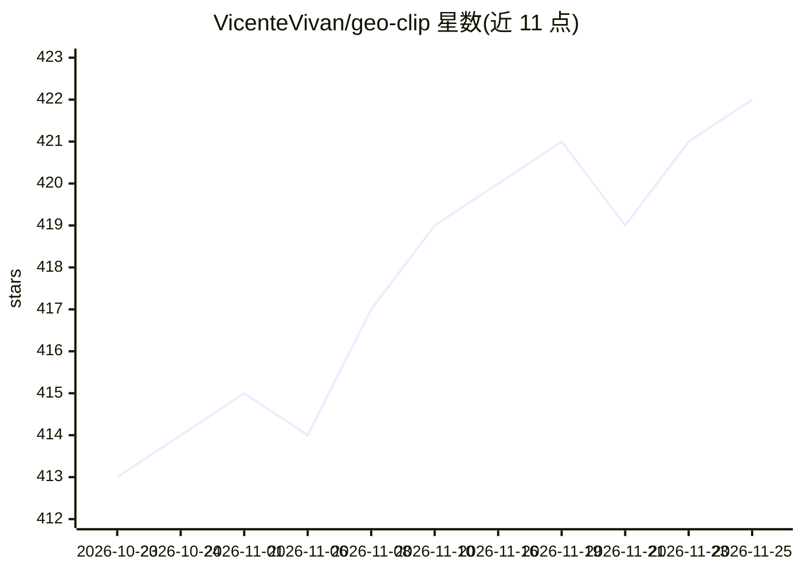

# VicenteVivan/geo-clip

⭐ 422 · Python · MIT · 推送 2026-11-17 · [GitHub](https://github.com/VicenteVivan/geo-clip) · [官网](https://arxiv.org/abs/2309.16020) · 组织维护

**图像地理定位研究者：从图片预测全球 GPS 位置**

NeurIPS 2023 论文 GeoCLIP 的官方 PyTorch 实现：通过对比学习对齐图像与 GPS 坐标，在 Im2GPS3k、YFCC26k、GWS15k、Geo-Tagged NUS-Wide 等基准数据集上进行图像地理定位。训练使用 4.7M 全球图像的 MP-16 数据集；位置编码器将地球建模为连续函数，可作为预训练 GPS 编码器为其他地理感知神经网络提供 GPS 特征。要求 Python 3.11+，通过 pip 或源码安装，提供 Colab demo。

## 筛选速览

| 维度 | 判定 | 备注 |
|---|---|---|
| AI 角色 | `ai-native` | 本体是模型或模型工具 |
| 许可风险 | `permissive` | MIT |
| 部署形态 | `library` | 以包/库形式分发 |
| 模型依赖 | — | README 未给出锁定关系 |
| 硬件要求 | — | 无带数字的原话,不猜 |
| 安装摩擦 | `low` | 无编译、无系统依赖或容器化 |
| 成熟度 | — | 结构信号不足 |

## 能力要点

- 图像到 GPS 位置的地理定位推理（GeoCLIP 类）
- 预训练位置编码器可输出全球 GPS 嵌入，供地理感知架构复用
- 基于 MP-16 数据集（4.7M 全球图像）对比训练
- 提供 Colab demo 与 pip 模块

## 适用场景

- 从照片预测拍摄地点的经纬度
- 为图像分类模型拼接 GPS 特征做地理感知分类
- 复用位置编码器作为地理感知神经网络的 GPS 编码模块

## 场景标签

`多模态` `图像视频处理` · 领域:感知与多模态

## 证据(README 行号)

> L12: GeoCLIP addresses the challenges of worldwide image geo-localization by introducing a novel CLIP-inspired approach 
> L18: Similarly to OpenAI's CLIP, GeoCLIP is trained contrastively by matching Image-GPS pairs. By using the MP-16 datase

## 星数曲线

2026-10-23 413 → 2026-11-25 422（+9）

---
*卡片 v1 · prompt 1.4 · 生成 2026-11-25 · 置信度 high · 依据 README sha `42f170d4850a` · [字段定义](../../DATASET.md)*
