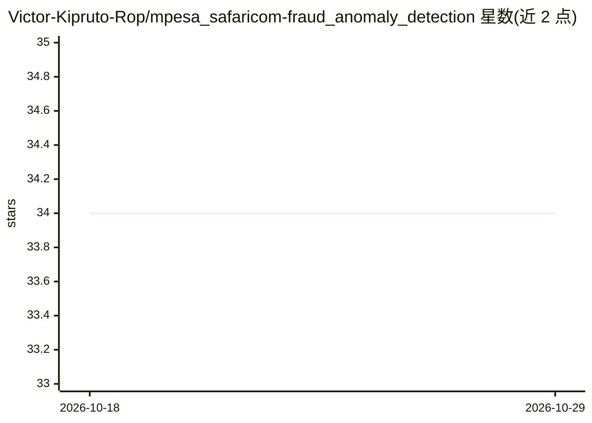

# Victor-Kipruto-Rop/mpesa_safaricom-fraud_anomaly_detection

⭐ 34 · Python · 推送 2026-08-12 · [GitHub](https://github.com/Victor-Kipruto-Rop/mpesa_safaricom-fraud_anomaly_detection) · 个人维护

**M-Pesa 移动支付交易的实时欺诈检测引擎**

面向 M-Pesa 移动钱币交易的实时欺诈检测组件：交易级规则检查（速率、SIM 换卡、夜间活动、骡子账户）、HistGradientBoosting 机器学习打分（校准概率、12 个特征）与决策聚合（加权评分、熔断器、审计日志）三层结构。提供 Flask REST API、Prometheus 指标、Docker/Kubernetes 部署资产与模型训练脚本。需 Python 3.10+ 与 PostgreSQL 13+，Redis 为可选缓存；依赖更上游的 streaming 平台代码路径运行测试。许可证为专有（M-Pesa/Safaricom）。

## 筛选速览

| 维度 | 判定 | 备注 |
|---|---|---|
| AI 角色 | `ai-native` | 本体是模型或模型工具 |
| 许可风险 | `none` | — |
| 部署形态 | `self-host` | docker 或自建部署 |
| 模型依赖 | — | README 未给出锁定关系 |
| 硬件要求 | — | 无带数字的原话,不猜 |
| 安装摩擦 | `low` | 无编译、无系统依赖或容器化 |
| 成熟度 | — | 结构信号不足 |

## 能力要点

- 三层评分：规则检查 + ML 打分 + 决策聚合（熔断器与审计日志）
- HistGradientBoosting 校准分类器，12 个工程特征，可选 SHAP 解释
- Flask REST API 与 Prometheus 指标、JSON 日志、不可变审计轨迹
- 提供模型训练脚本（生成校准模型与模型卡）与 Docker/K8s 部署文档

## 适用场景

- 对 M-Pesa 交易做实时欺诈风险打分与拦截决策
- 训练并迭代欺诈检测模型（含 SMOTE 不平衡处理与 SHAP 解释）
- 在生产环境部署带监控与回滚流程的检测流水线

## 场景标签

`网络安全` · 领域:学习与行业

## 证据(README 行号)

> L3: A production-grade, real-time fraud detection engine for M-Pesa mobile money transactions. It combines rule-based ch
> L40: 1. **Transaction-level checks** — velocity, SIM swap, night-hour activity, mule accounts
> L41: 2. **ML scoring** — HistGradientBoosting with calibrated probabilities

## 星数曲线

2026-10-18 34 → 2026-10-29 34（+0）

---
*卡片 v1 · prompt 1.4 · 生成 2026-10-25 · 置信度 mid · 依据 README sha `cc966d459d84` · [字段定义](../../DATASET.md)*
