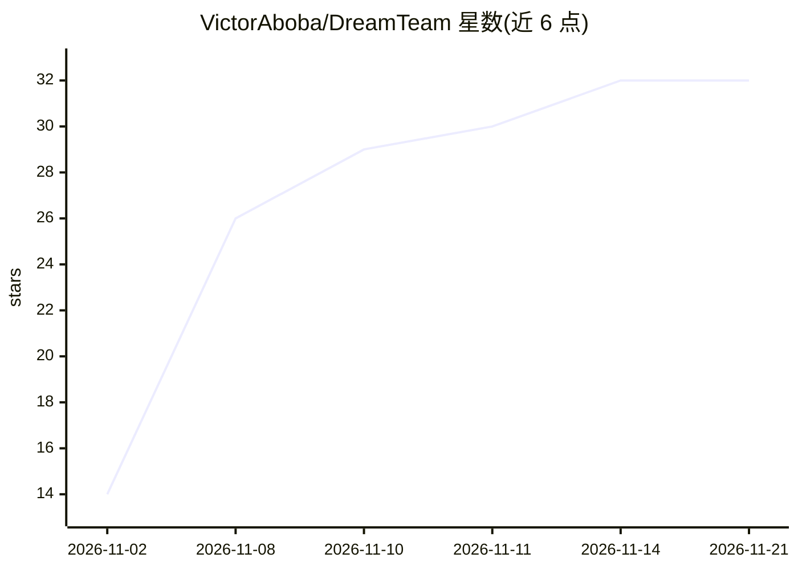

# VictorAboba/DreamTeam

⭐ 32 · Python · MIT · 推送 2026-11-20 · [GitHub](https://github.com/VictorAboba/DreamTeam) · 个人维护 · 中文 README

**无中心节点的自组织 AI agent 集群：给目标即分工协作交付**

多智能体集群运行时：用户设定目标后，规划任务被放上共享任务板，空闲 agent 认领、互相评审、在任务线程与私信中沟通，共享一个 git 工作区；agent 可通过 mcp_create 编写自己的 MCP 工具，整个集群本身也作为 MCP server 供 Claude Code 连接参与。支持 Claude、OpenAI、OpenRouter、Ollama、vLLM 等任意 OpenAI 兼容端点，可按 agent 分配不同模型并做 token/美元记账与预算暂停。状态存于单个 SQLite 文件，重启后可继续；提供终端 UI、Web 看板、MCP、REST+WebSocket 四种接口。限制：服务器监听 127.0.0.1 且无鉴权，agent 命令以用户权限运行，不信任的目标需用 Docker 沙箱。

## 筛选速览

| 维度 | 判定 | 备注 |
|---|---|---|
| AI 角色 | `ai-native` | 本体是模型或模型工具 |
| 许可风险 | `permissive` | MIT |
| 部署形态 | `self-host` | docker 或自建部署 |
| 模型依赖 | local-ok | 支持本地模型 |
| 硬件要求 | — | 无带数字的原话,不猜 |
| 安装摩擦 | `low` | 无编译、无系统依赖或容器化 |
| 成熟度 | — | 结构信号不足 |

## 能力要点

- 共享任务板上的原子认领、依赖阻塞与独立评审机制
- agent 可自写 MCP 工具（mcp_create），集群自身也是 MCP server
- 每次 LLM 调用的思考、工具调用、token 与成本全量可追溯
- SQLite 单文件状态存储，重启续跑，可离线跑基准测试

## 适用场景

- 给一组 AI agent 一个软件开发目标，让它们自组织分工完成
- 通过 Claude Code 作为用户或队友接入并监督集群工作
- 在隔离的 Docker 沙箱中无人值守地运行 agent 任务

## 场景标签

`多智能体` `编码 Agent` · 领域:Agent 开发

## 证据(README 行号)

> L9: **A self-organizing swarm of AI agents with no leader.** You give the swarm a goal; agents with human names
> L11: messages, share a git workspace, set themselves triggers and write their own tools as MCP servers.
> L44: - **Any model.** Claude, OpenAI, OpenRouter, Ollama, vLLM, LM Studio or any OpenAI-compatible endpoint, with a

## 星数曲线

2026-11-02 14 → 2026-11-21 32（+18）

---
*卡片 v1 · prompt 1.4 · 生成 2026-11-18 · 置信度 mid · 依据 README sha `4b07ac79234a` · [字段定义](../../DATASET.md)*
