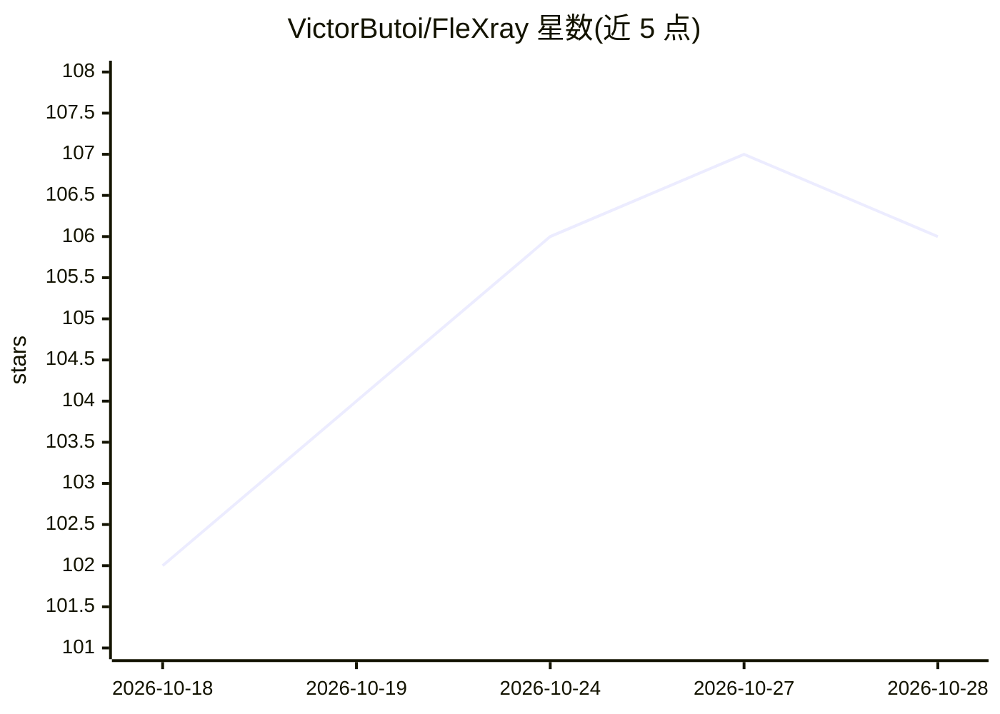

# VictorButoi/FleXray

⭐ 109 · Python · MIT · 推送 2026-09-23 · [GitHub](https://github.com/VictorButoi/FleXray) · [官网](https://flexray.csail.mit.edu/) · 组织维护

**通用临床 X 光解剖分割模型：CLI/Python/MCP 三种入口**

pip 包 flexray（import 名 fxr），对 PNG/JPEG/TIFF/BMP 及可选 DICOM 输入输出解剖结构分割：每张图写出阈值化掩码、逐通道概率与原始 logits 三个 .npy 数组及标签命名 json。提供 flexify 命令行（四档质量等级、二值单标签、集成成员选择）、Python API、以及供 Claude 等客户端调用的 MCP 服务器。亦支持训练自有模型：2D X 光数据与 CT 体渲染 DRR 结合，含数据打包 CLI、DRR 渲染、标签协议调和与 YAML 配置系统，本地训练支持 CPU/CUDA 单 GPU。预训练权重托管于 Hugging Face。

## 筛选速览

| 维度 | 判定 | 备注 |
|---|---|---|
| AI 角色 | `ai-native` | 本体是模型或模型工具 |
| 许可风险 | `permissive` | MIT |
| 部署形态 | `library` | 以包/库形式分发 |
| 模型依赖 | — | README 未给出锁定关系 |
| 硬件要求 | — | 无带数字的原话,不猜 |
| 安装摩擦 | `medium` | 含编译或系统依赖之一 |
| 成熟度 | — | 结构信号不足 |

## 能力要点

- flexify 命令行输出掩码/概率/logits 三种 .npy 数组
- MCP 服务器支持 Claude Code/Desktop 自然语言调用分割
- 训练管线：CT→DRR 渲染、数据打包、标签协议调和、配置驱动 sweep
- 支持 --init-from 微调到自定义标签协议

## 适用场景

- 对 X 光影像批量生成解剖结构分割掩码
- 在自定义数据集上微调或重训 X 光分割模型
- 通过 Claude 等客户端以自然语言执行 X 光分割

## 场景标签

`目标检测` `微调` · 领域:感知与多模态

## 证据(README 行号)

> L22: FleXray (pip package `flexray`, imported as `fxr`) is a command-line tool and
> L34: FleXray is a segmentation model that outputs anatomical segmentations for

## 星数曲线

2026-10-18 102 → 2026-10-28 106（+4）

---
*卡片 v1 · prompt 1.4 · 生成 2026-10-23 · 置信度 high · 依据 README sha `acb517f1f6d1` · [字段定义](../../DATASET.md)*
