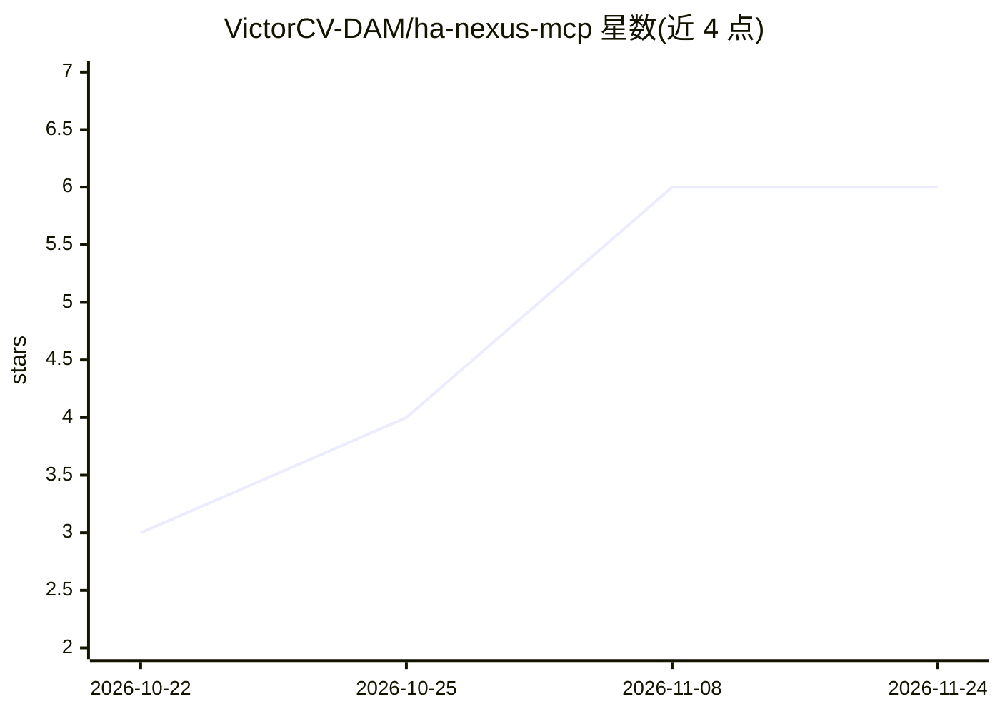

# VictorCV-DAM/ha-nexus-mcp

⭐ 6 · Python · MIT · 推送 2026-11-15 · [GitHub](https://github.com/VictorCV-DAM/ha-nexus-mcp) · 个人维护

**Home Assistant 的点击即装 Agentic MCP 对话客户端**

以 Home Assistant 自定义集成（HACS 默认仓库成员）形式提供，将 HA 接入云端或本地 LLM，注册为官方 Assist 会话代理，通过原生 Tool Calling（实体搜索/状态读取/服务调用）以语音或文本控制智能家居；助手可生成 YAML 自动化并一键保存激活、热创建 Helper 而无需重启；带自定义 Lovelace 聊天卡片、多模态图片粘贴诊断、跨设备历史同步与 10 个遥测传感器。零外部 Python 依赖，支持热重配置模型与凭据。

## 筛选速览

| 维度 | 判定 | 备注 |
|---|---|---|
| AI 角色 | `ai-native` | 本体是模型或模型工具 |
| 许可风险 | `permissive` | MIT |
| 部署形态 | `None` |  |
| 模型依赖 | local-ok | 支持本地模型 |
| 硬件要求 | — | 无带数字的原话,不猜 |
| 安装摩擦 | `low` | 无编译、无系统依赖或容器化 |
| 成熟度 | — | 结构信号不足 |

## 能力要点

- 注册为 HA Assist 官方会话代理，支持语音卫星与网页/移动端
- 内置 ha_search_entities / ha_get_entity_state / ha_call_service 工具，遵循 exposed entity 权限
- 一键解析并激活 YAML 自动化、热创建 Helper（零重启）
- 支持多模态图片粘贴诊断与跨设备会话历史同步

## 适用场景

- 用自然语言或语音让 AI 帮我查找设备并创建自动化
- 粘贴摄像头快照或报错截图让 AI 做诊断
- 在不重启 Home Assistant 的情况下切换模型或更新 API 凭据

## 场景标签

`语音 Agent` `聊天机器人` · 领域:对话与助手

## 证据(README 行号)

> L17:  The Ultra-Lightweight Click & Install Agentic Intercom for Home Assistant
> L66: Ask your smart home in plain natural language (voice or text). Nexus MCP searches entities, designs the automation,
> L136: * **🛠️ Native Tool Calling & Smart Assistance**:

## 星数曲线

2026-10-22 3 → 2026-11-24 6（+3）

---
*卡片 v1 · prompt 1.4 · 生成 2026-11-20 · 置信度 high · 依据 README sha `819b19e540d5` · [字段定义](../../DATASET.md)*
