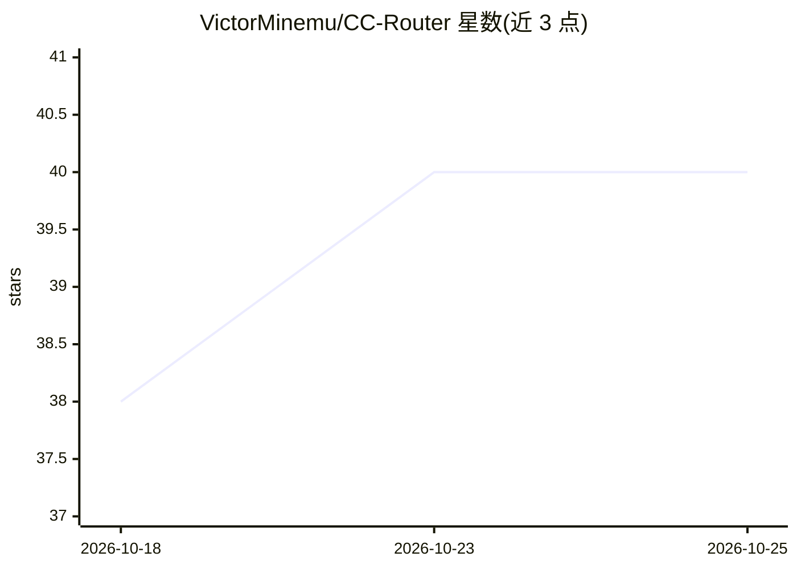

# VictorMinemu/CC-Router

⭐ 40 · TypeScript · MIT · 推送 2026-08-31 · [GitHub](https://github.com/VictorMinemu/CC-Router) · [官网](https://www.npmjs.com/package/ai-cc-router) · 个人维护

**本地多账号代理：在多个 Claude Max/OpenAI 订阅间轮询分流请求**

面向 Claude Code 与 Codex CLI 用户的本地反向代理：把请求在 2-20 个 Claude Max 订阅账号间轮询分发，OAuth token 自动刷新并原子化落盘；检测 429/529 限流后冷却账号并选负载最低者。支持 openai/* 模型路由到 ChatGPT/Codex 订阅账号，并在 Anthropic Messages 与 OpenAI Responses 请求格式间双向转换。提供交互式 setup 向导（macOS 可直接从 Keychain 提取 token）、实时终端面板、客户端模式与 Docker Compose 部署。代理本身不实现用户认证，互联网暴露需在 nginx 层加认证。

## 筛选速览

| 维度 | 判定 | 备注 |
|---|---|---|
| AI 角色 | `ai-ecosystem` | LLM/agent 周边工具 |
| 许可风险 | `permissive` | MIT |
| 部署形态 | `self-host` | docker 或自建部署 |
| 模型依赖 | locked-api |  |
| 硬件要求 | — | 无带数字的原话,不猜 |
| 安装摩擦 | `low` | 无编译、无系统依赖或容器化 |
| 成熟度 | `idea` | |

## 能力要点

- 2-20 个 Claude 订阅账号 round-robin 轮询与自动 token 刷新
- 429/529 限流感知、账号冷却与最小负载选择
- OpenAI Responses 兼容端点供 Codex CLI 使用，含 Anthropic/OpenAI 请求格式互转
- 服务器模式 + 客户端模式支持团队共享账号部署

## 适用场景

- 单账号频繁触发限流的重度 Claude Code 用户合并多个订阅额度
- 小团队用少量共享订阅服务多名开发者
- 让 Claude Code 与 Codex CLI 走同一个本地代理

## 场景标签

`模型网关` · 领域:Agent 开发

## 证据(README 行号)

> L13: - **Round-robin token rotation** — distribute requests across 2-20 Claude Max accounts automatically
> L224: Claude Code → cc-router:3456 → api.anthropic.com

## 星数曲线

2026-10-18 38 → 2026-10-25 40（+2）

---
*卡片 v1 · prompt 1.4 · 生成 2026-10-25 · 置信度 high · 依据 README sha `7aa9d88062bd` · [字段定义](../../DATASET.md)*
