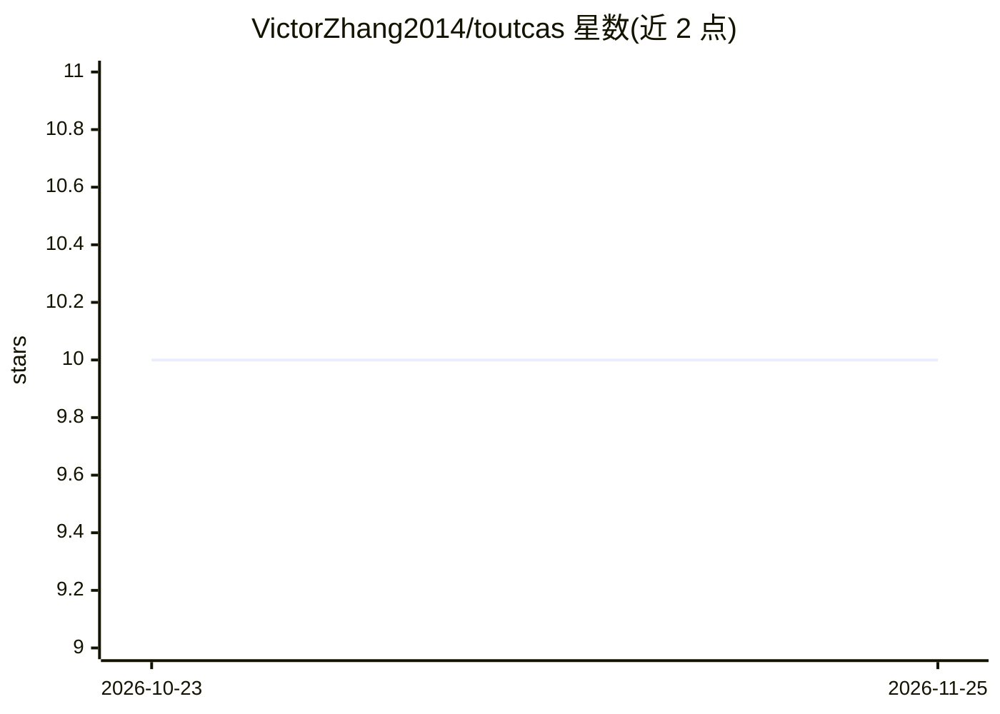

# VictorZhang2014/toutcas

⭐ 10 · Dart · 推送 2026-08-11 · [GitHub](https://github.com/VictorZhang2014/toutcas) · 个人维护

**用后即焚机制的 AI 助手浏览器，零远程数据留存**

一款受 ChatGPT Atlas 启发的 agentic AI 网页浏览器，核心是用后即焚（BAU）机制与非托管数据设计：AI 交互过程中不在远程服务器持久存储用户数据，采用安全多租户架构。内置接入多个 LLM（gpt-oss-120b、DeepSeek V3.2 Exp、Mistral-7B-Instruct-v0.2），通过 RAG 与嵌入检索提供网页分析与 PDF 理解。后端 Python/Flask + transformers，客户端 Flutter；README 列出环境版本与学术引用，未给出具体安装命令。

## 筛选速览

| 维度 | 判定 | 备注 |
|---|---|---|
| AI 角色 | `ai-native` | 本体是模型或模型工具 |
| 许可风险 | `none` | — |
| 部署形态 | `None` |  |
| 模型依赖 | — | README 未给出锁定关系 |
| 硬件要求 | — | 无带数字的原话,不猜 |
| 安装摩擦 | `low` | 无编译、无系统依赖或容器化 |
| 成熟度 | — | 结构信号不足 |

## 能力要点

- Burn-After-Use 机制：AI 交互不留存用户数据
- 多租户安全架构的非托管设计
- 内置 gpt-oss-120b、DeepSeek V3.2 Exp、Mistral-7B 三个 LLM
- RAG + 嵌入检索驱动的网页与 PDF 理解

## 适用场景

- 对数据留存敏感场景下与 LLM 对话并分析网页
- 阅读 PDF 并借助 RAG 检索提问
- 研究企业级 LLM 防数据泄露的交互模型

## 场景标签

`AI 助手` `RAG` · 领域:对话与助手

## 证据(README 行号)

> L2: Nothing stored. Nothing shared. A Burn-After-Use AI assistant.
> L14: - ✅ An agentic AI web browser, inspired by `ChatGPT Atlas`
> L18: - ✅ Native web page analysis and PDF understanding powered by Retrieval-Augmented Generation (RAG) and embedding-ba

## 星数曲线

2026-10-23 10 → 2026-11-25 10（+0）

---
*卡片 v1 · prompt 1.4 · 生成 2026-11-20 · 置信度 mid · 依据 README sha `fec225daf55f` · [字段定义](../../DATASET.md)*
