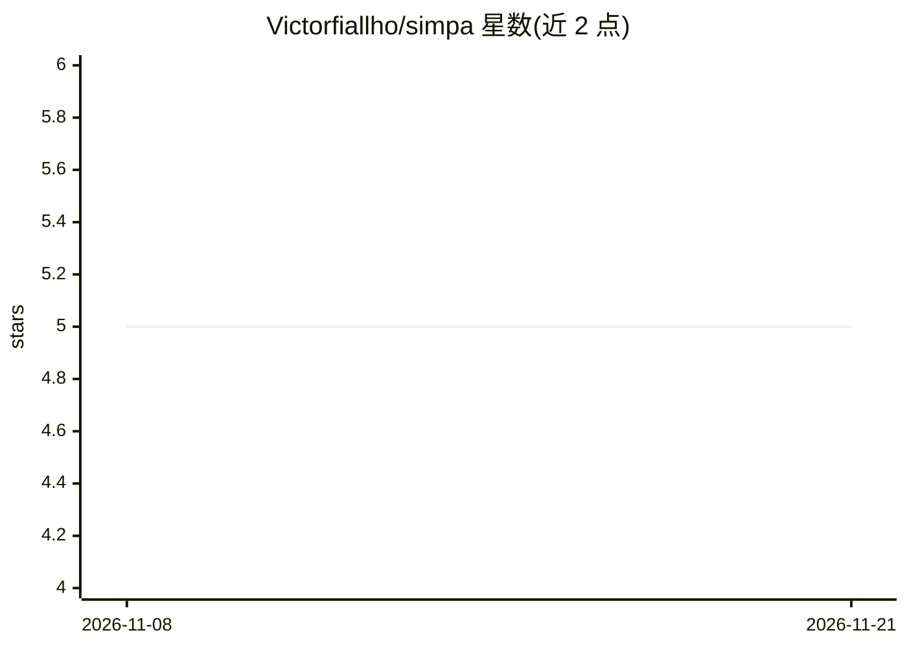

# Victorfiallho/simpa

⭐ — · [GitHub]() · 个人维护

**高校学生学业成绩监控与风险预测平台**

面向高校场景的学业监控与预测平台（UniEVANGÉLICA 人工智能专业课程项目），由 Docker Compose 编排的微服务组成：React 前端、nginx 网关、FastAPI 的认证/教务/分析三个服务、PostgreSQL 17 与 RabbitMQ 事件队列（outbox 模式）。登记成绩与出勤后，分析服务 worker 消费事件、按回归计算风险并生成指标解读、推荐与报表；附带 Prometheus/Grafana 队列监控与 AES-256-GCM 加密备份，备份缺少保留、调度与外部副本能力。

## 筛选速览

| 维度 | 判定 | 备注 |
|---|---|---|
| AI 角色 | `ai-native` | 本体是模型或模型工具 |
| 许可风险 | `none` | — |
| 部署形态 | `self-host` | docker 或自建部署 |
| 模型依赖 | — | README 未给出锁定关系 |
| 硬件要求 | — | 无带数字的原话,不猜 |
| 安装摩擦 | `low` | 无编译、无系统依赖或容器化 |
| 成熟度 | — | 结构信号不足 |

## 能力要点

- 单条 Docker Compose 命令启动全部微服务，各服务独立数据库
- RabbitMQ outbox 模式事件驱动：成绩写入后 worker 自动重算风险
- JWT RS256 认证、X-Request-ID 追踪、Swagger 文档
- Prometheus/Alertmanager/Grafana 队列监控与加密备份脚本

## 适用场景

- 登记学生成绩与出勤并自动计算学业风险
- 查看指标面板、预测与推荐及风险历史报表
- 开发环境用演示账号通过 Swagger 调试 API

## 场景标签

`数据分析` · 领域:效率与自动化

## 证据(README 行号)

> L7: Plataforma para registrar notas e frequência, calcular indicadores estatísticos, classificar risco acadêmico com jus
> L26: |`analitico`|Painel, indicadores, interpretação automática, predição por regressão, recomendações, histórico de ris
> L28: |`analitico-worker`|Consome os eventos, recalcula o risco, ignora repetidos e manda o que falhou para a fila de fal

## 星数曲线

2026-11-08 5 → 2026-11-21 5（+0）

---
*卡片 v1 · prompt 1.4 · 生成 2026-11-21 · 置信度 mid · 依据 README sha `4043f503bb22` · [字段定义](../../DATASET.md)*
