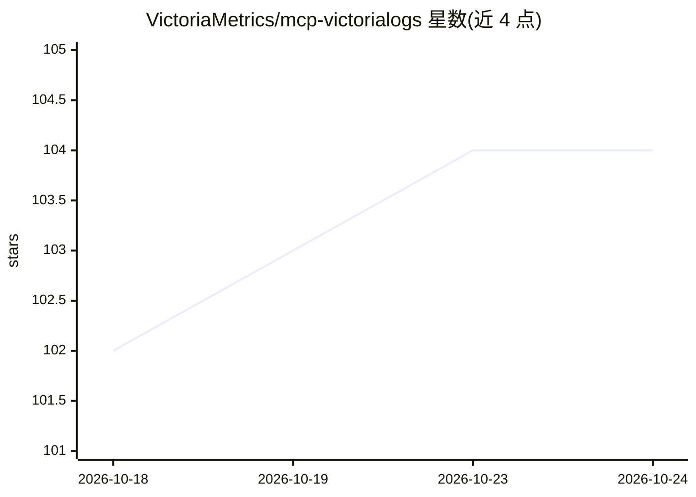

# VictoriaMetrics/mcp-victorialogs

⭐ 105 · Go · Apache-2.0 · 推送 2026-10-16 · [GitHub](https://github.com/VictoriaMetrics/mcp-victorialogs) · [官网](https://victoriametrics.com/) · 组织维护

**VictoriaLogs 的 MCP 服务器：让 AI 客户端查询与分析日志**

VictoriaMetrics 公司为 VictoriaLogs 日志数据库实现的 Model Context Protocol 服务器，面向使用 MCP 客户端的工程师。暴露 VictoriaLogs 几乎全部只读 API 为工具：LogsQL 查询、流/字段/字段值列举、日志统计查询等 13 个工具，并内嵌文档向量库支持离线文档搜索。支持 stdio/SSE/Streamable HTTP 三种模式，提供 Go 安装、二进制、Docker、Helm 多种部署方式及 /metrics、健康检查端点，附 Cursor、Claude Desktop、VS Code、Zed、JetBrains 等客户端配置示例。

## 筛选速览

| 维度 | 判定 | 备注 |
|---|---|---|
| AI 角色 | `ai-ecosystem` | LLM/agent 周边工具 |
| 许可风险 | `permissive` | Apache-2.0 |
| 部署形态 | `desktop` | 安装包/桌面程序 |
| 模型依赖 | — | README 未给出锁定关系 |
| 硬件要求 | — | 无带数字的原话,不猜 |
| 安装摩擦 | `low` | 无编译、无系统依赖或容器化 |
| 成熟度 | — | 结构信号不足 |

## 能力要点

- 13 个工具覆盖 LogsQL 查询、流/字段列举与日志统计
- 内嵌文档向量库，documentation 工具可离线搜索文档
- stdio/SSE/Streamable HTTP 三种运行模式
- 提供 Go 安装、预编译二进制、Docker 镜像与 Helm chart

## 适用场景

- 在 IDE 或 AI 助手中直接用自然语言排查 VictoriaLogs 日志
- 通过 LogsQL 查询与日志统计做可观测性分析
- 让 AI agent 检索 VictoriaLogs 文档辅助排障

## 场景标签

`数据分析` · 领域:效率与自动化

## 证据(README 行号)

> L9: The implementation of Model Context Protocol (MCP) server for VictoriaLogs.
> L16: This MCP server allows you to use almost all read-only APIs of VictoriaLogs, i.e. all functions available in Web UI
> L333: MCP VictoriaLogs provides numerous tools for interacting with your VictoriaLogs instance.

## 星数曲线

2026-10-18 102 → 2026-10-24 104（+2）

---
*卡片 v1 · prompt 1.4 · 生成 2026-10-23 · 置信度 high · 依据 README sha `4fe7bfb0184c` · [字段定义](../../DATASET.md)*
