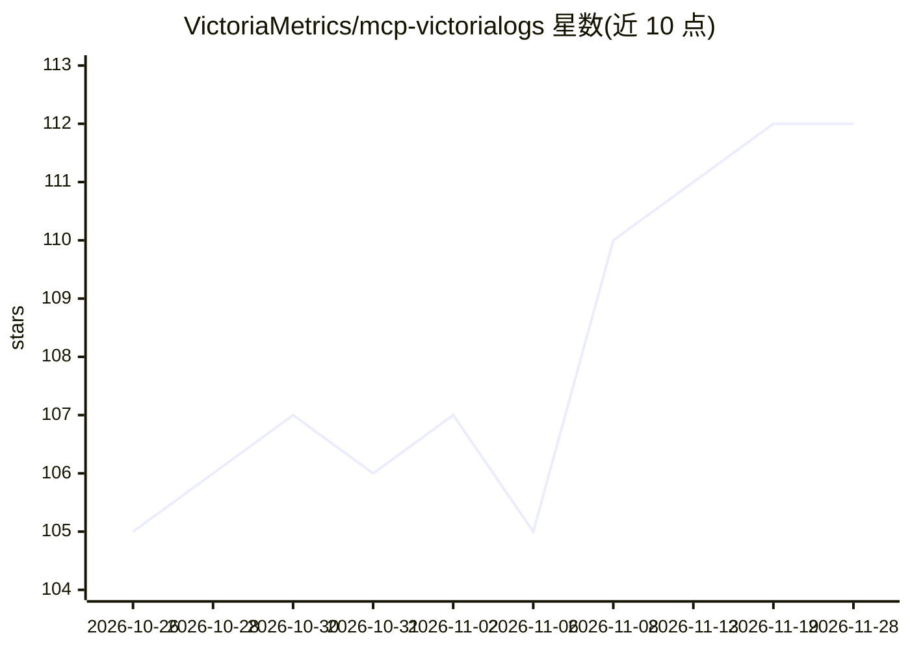

# VictoriaMetrics/mcp-victorialogs

⭐ 112 · Go · Apache-2.0 · 推送 2026-11-25 · [GitHub](https://github.com/VictoriaMetrics/mcp-victorialogs) · [官网](https://victoriametrics.com/) · 组织维护

**VictoriaLogs 的 MCP 服务器：让 AI 客户端查询和调试日志**

为 VictoriaLogs 实现的 Model Context Protocol 服务器，向 AI 客户端暴露 VictoriaLogs 的只读 API：查询与浏览日志、查看实例参数、列出流与字段、以指标形式返回日志统计，并内置可离线搜索的文档。支持 stdio/SSE/Streamable HTTP 三种传输模式，可接入 VictoriaMetrics Cloud 部署，提供环境变量配置、Prometheus 指标、健康检查与 Bearer 认证，并给出 Cursor、Claude Desktop、Claude Code、Codex 等客户端的接入配置。要求已有 VictoriaLogs 实例或云账户。

## 筛选速览

| 维度 | 判定 | 备注 |
|---|---|---|
| AI 角色 | `ai-ecosystem` | LLM/agent 周边工具 |
| 许可风险 | `permissive` | Apache-2.0 |
| 部署形态 | `desktop` | 安装包/桌面程序 |
| 模型依赖 | — | README 未给出锁定关系 |
| 硬件要求 | — | 无带数字的原话,不猜 |
| 安装摩擦 | `low` | 无编译、无系统依赖或容器化 |
| 成熟度 | — | 结构信号不足 |

## 能力要点

- 暴露 VictoriaLogs 几乎全部只读 API（查询日志、字段、流、统计指标）
- 内置最新文档并可离线搜索
- 支持 stdio/sse/http 三种传输模式与 Helm 部署
- 提供根端点工具检查页、Prometheus 指标与健康检查端点

## 适用场景

- 在 Claude Desktop / Cursor 里用自然语言查询和分析 VictoriaLogs 日志
- 让 AI 客户端辅助排查 VictoriaLogs 实例的观测与调试任务
- 结合其他 observability MCP 服务器组合使用

## 场景标签

 · 领域:可观测性/日志基础设施

## 证据(README 行号)

> L9: The implementation of Model Context Protocol (MCP) server for VictoriaLogs.
> L11: This provides access to your VictoriaLogs instance and seamless integration with VictoriaLogs APIs and documentatio
> L16: This MCP server allows you to use almost all read-only APIs of VictoriaLogs, i.e. all functions available in Web UI

## 星数曲线

2026-10-26 105 → 2026-11-28 112（+7）

---
*卡片 v1 · prompt 1.4 · 生成 2026-11-28 · 置信度 high · 依据 README sha `b1969711a73e` · [字段定义](../../DATASET.md)*
