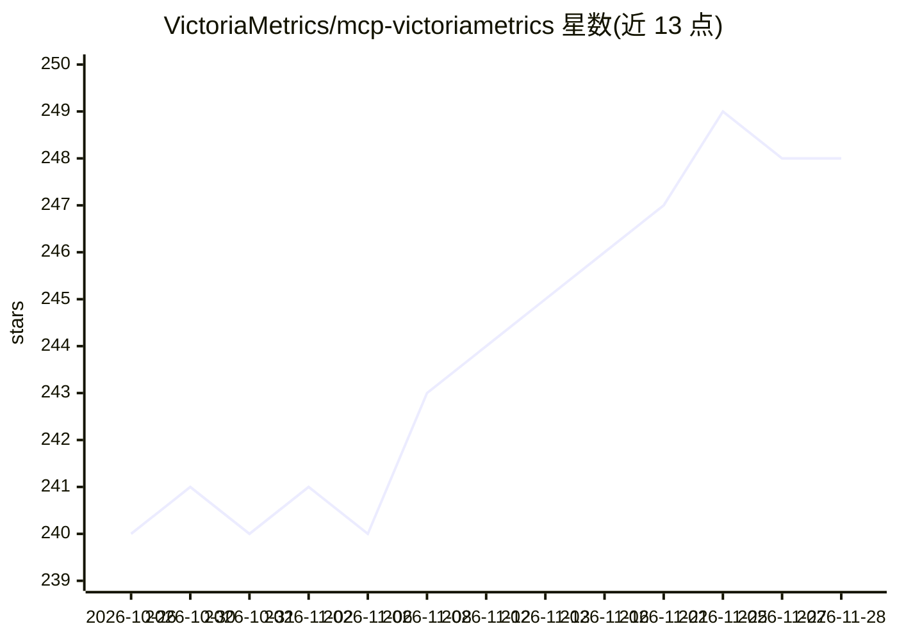

# VictoriaMetrics/mcp-victoriametrics

⭐ 248 · Go · Apache-2.0 · 推送 2026-11-26 · [GitHub](https://github.com/VictoriaMetrics/mcp-victoriametrics) · [官网](https://victoriametrics.com/) · 组织维护

**面向工程师的 VictoriaMetrics MCP 服务器，接入监控与查询 API**

VictoriaMetrics 官方实现的 Model Context Protocol 服务器，让 MCP 客户端读取 VictoriaMetrics 实例：暴露 VMUI 中可用的只读 API（指标查询/导出、标签与基数探索、告警与记录规则测试、查询解释与调试、relabel/降采样/保留策略调试），并内嵌可离线检索的 VictoriaMetrics 文档。支持 stdio/SSE/Streamable HTTP 三种模式，提供二进制、Docker、源码编译与 Helm 安装途径，可接入 VictoriaMetrics Cloud。需要已运行的 VictoriaMetrics 或 Cloud 实例。

## 筛选速览

| 维度 | 判定 | 备注 |
|---|---|---|
| AI 角色 | `ai-ecosystem` | LLM/agent 周边工具 |
| 许可风险 | `permissive` | Apache-2.0 |
| 部署形态 | `desktop` | 安装包/桌面程序 |
| 模型依赖 | — | README 未给出锁定关系 |
| 硬件要求 | — | 无带数字的原话,不猜 |
| 安装摩擦 | `low` | 无编译、无系统依赖或容器化 |
| 成熟度 | — | 结构信号不足 |

## 能力要点

- 暴露 VictoriaMetrics 几乎全部只读 API（查询、导出、基数、规则调试等）
- 内嵌可离线检索的最新 VictoriaMetrics 文档
- 支持 stdio/SSE/Streamable HTTP 三种传输模式
- 提供二进制、Docker、源码、Helm 多种安装方式并支持 VictoriaMetrics Cloud

## 适用场景

- 在 MCP 客户端中对话式查询与调试 VictoriaMetrics 指标
- 测试与分析告警和记录规则
- 探索数据基数与指标使用统计
- 离线检索 VictoriaMetrics 文档辅助排障

## 场景标签

`RAG` · 领域:知识与检索

## 证据(README 行号)

> L10: The implementation of Model Context Protocol (MCP) server for VictoriaMetrics.
> L17: This MCP server allows you to use almost all read-only APIs of VictoriaMetrics, i.e. all functions available in VMU
> L140: |`MCP_SERVER_MODE`|Server operation mode. See Modes for details.|No|`stdio`|`stdio`, `sse`, `http`|

## 星数曲线

2026-10-26 240 → 2026-11-28 248（+8）

---
*卡片 v1 · prompt 1.4 · 生成 2026-11-27 · 置信度 high · 依据 README sha `3c5b9eeb64d2` · [字段定义](../../DATASET.md)*
