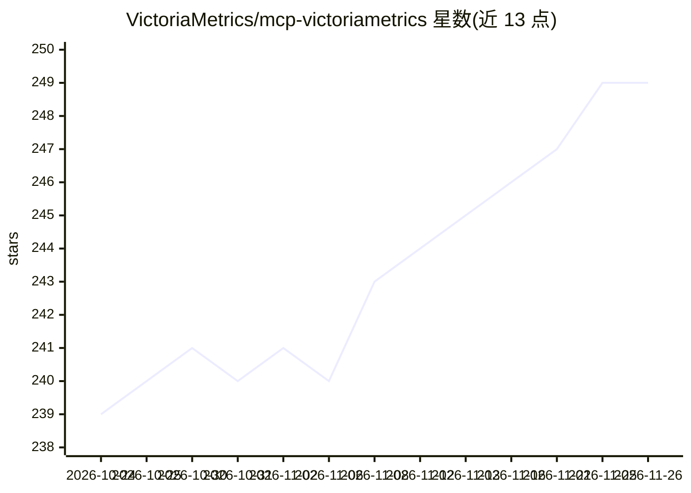

# VictoriaMetrics/mcp-victoriametrics

⭐ 249 · Go · Apache-2.0 · 推送 2026-11-24 · [GitHub](https://github.com/VictoriaMetrics/mcp-victoriametrics) · [官网](https://victoriametrics.com/) · 组织维护

**VictoriaMetrics 的 MCP 服务器：让 MCP 客户端操作监控实例**

为 VictoriaMetrics 实现的 Model Context Protocol (MCP) 服务器，向 MCP 客户端暴露 VictoriaMetrics 的只读 API：查询与导出指标、分析告警与记录规则、基数探索、查询解释与调试等，并内置可离线搜索的文档。支持 stdio、SSE、Streamable HTTP 三种传输模式，通过环境变量配置连接自建实例或 VictoriaMetrics Cloud。提供二进制、Docker、源码编译和 Helm 四种安装方式，README 给出 Claude Desktop/Claude Code 客户端接入配置。

## 筛选速览

| 维度 | 判定 | 备注 |
|---|---|---|
| AI 角色 | `ai-ecosystem` | LLM/agent 周边工具 |
| 许可风险 | `permissive` | Apache-2.0 |
| 部署形态 | `desktop` | 安装包/桌面程序 |
| 模型依赖 | — | README 未给出锁定关系 |
| 硬件要求 | — | 无带数字的原话,不猜 |
| 安装摩擦 | `low` | 无编译、无系统依赖或容器化 |
| 成熟度 | — | 结构信号不足 |

## 能力要点

- 暴露 VictoriaMetrics 几乎全部只读 API（VMUI 中可用的功能）
- 内嵌最新文档并支持无网搜索
- 支持 stdio/SSE/Streamable HTTP 三种传输模式
- 支持直连实例与 VictoriaMetrics Cloud（API key）两种接入方式

## 适用场景

- 在 MCP 客户端中对话式查询和探索 VictoriaMetrics 指标
- 调试 relabel 规则、降采样与保留策略配置
- 在无网环境下搜索内嵌的 VictoriaMetrics 文档
- 用 MCP 工具分析告警与记录规则

## 场景标签

 · 领域:监控/可观测性

## 证据(README 行号)

> L10: The implementation of Model Context Protocol (MCP) server for VictoriaMetrics.
> L17: This MCP server allows you to use almost all read-only APIs of VictoriaMetrics, i.e. all functions available in VMU
> L29: In addition, the MCP server contains embedded up-to-date documentation and is able to search it without online acce

## 星数曲线

2026-10-24 239 → 2026-11-26 249（+10）

---
*卡片 v1 · prompt 1.4 · 生成 2026-11-25 · 置信度 high · 依据 README sha `2883f72ee9b0` · [字段定义](../../DATASET.md)*
