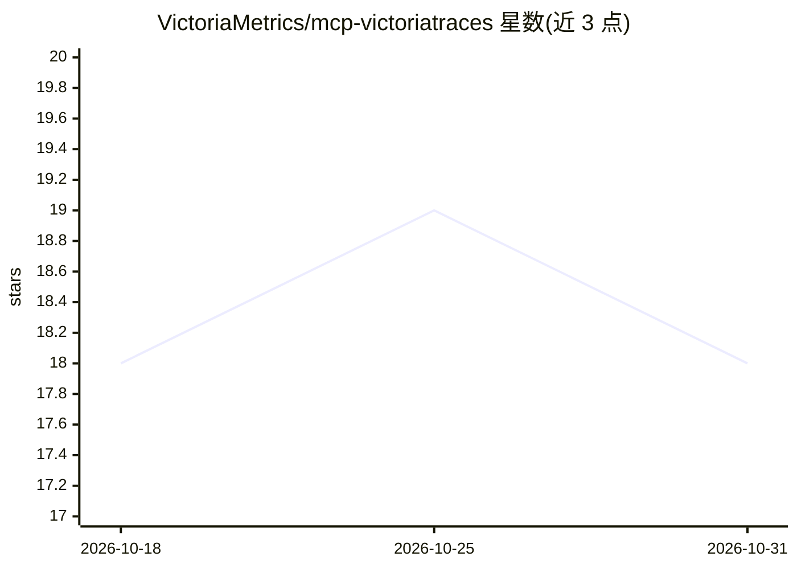

# VictoriaMetrics/mcp-victoriatraces

⭐ 18 · Go · Apache-2.0 · 推送 2026-10-16 · [GitHub](https://github.com/VictoriaMetrics/mcp-victoriatraces) · [官网](https://victoriametrics.com) · 组织维护

**为 VictoriaTraces 链路追踪系统提供 MCP 服务器接入**

VictoriaMetrics 官方维护的 Model Context Protocol（MCP）服务器实现，面向使用 MCP 客户端（Cursor、Claude Desktop、Claude Code、VS Code、Zed、JetBrains IDE、Windsurf）的工程师。封装 VictoriaTraces 几乎全部只读 API：查询服务列表、span 操作名、trace 查询与详情、服务依赖图，并内嵌可离线检索的文档。支持 stdio/SSE/Streamable HTTP 三种传输模式与 Docker、Helm、二进制、Go 安装等多种部署方式；响应质量依赖所连接的客户端与模型能力，README 附有免责声明。

## 筛选速览

| 维度 | 判定 | 备注 |
|---|---|---|
| AI 角色 | `ai-ecosystem` | LLM/agent 周边工具 |
| 许可风险 | `permissive` | Apache-2.0 |
| 部署形态 | `desktop` | 安装包/桌面程序 |
| 模型依赖 | — | README 未给出锁定关系 |
| 硬件要求 | — | 无带数字的原话,不猜 |
| 安装摩擦 | `low` | 无编译、无系统依赖或容器化 |
| 成熟度 | — | 结构信号不足 |

## 能力要点

- 封装 VictoriaTraces 只读 API：服务、span 名、trace 查询与依赖图
- 内嵌文档支持离线搜索
- stdio/SSE/Streamable HTTP 三种传输模式，提供 /metrics 与健康检查端点
- 提供 Cursor、Claude、VS Code、Zed、JetBrains、Windsurf 等客户端配置示例

## 适用场景

- 在 AI 编程助手中直接查询和分析链路追踪数据
- 通过对话式客户端排查服务依赖与 trace 问题
- 让 agent 离线检索 VictoriaTraces 文档

## 场景标签

 · 领域:可观测性/LLM 工具生态

## 证据(README 行号)

> L10: The implementation of Model Context Protocol (MCP) server for VictoriaTraces.
> L12: This provides access to your VictoriaTraces instance and seamless integration with VictoriaTraces APIs and document

## 星数曲线

2026-10-18 18 → 2026-10-31 18（+0）

---
*卡片 v1 · prompt 1.4 · 生成 2026-10-28 · 置信度 high · 依据 README sha `0d72d2a96c7f` · [字段定义](../../DATASET.md)*
