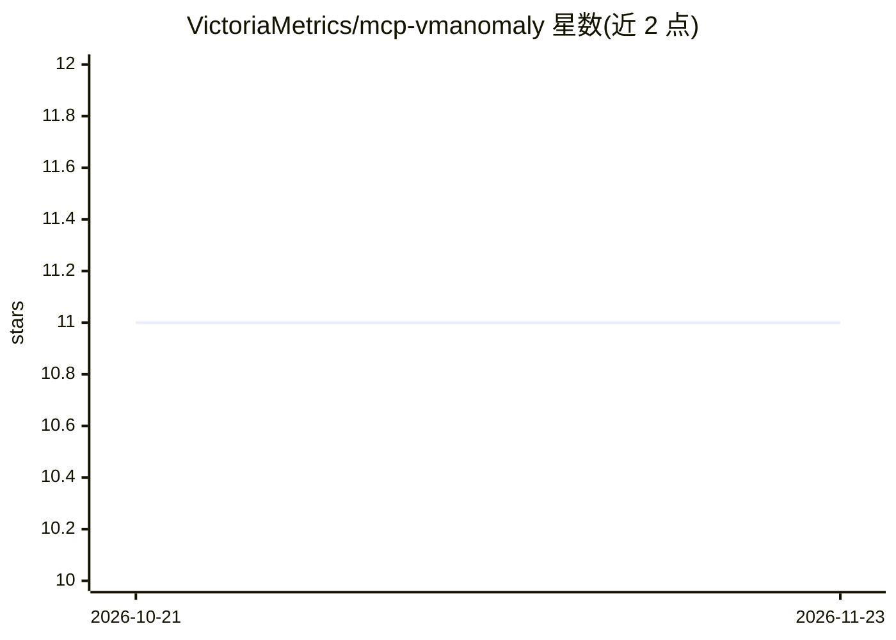

# VictoriaMetrics/mcp-vmanomaly

⭐ 11 · Go · Apache-2.0 · 推送 2026-11-22 · [GitHub](https://github.com/VictoriaMetrics/mcp-vmanomaly) · [官网](https://victoriametrics.com/) · 组织维护

**为 VictoriaMetrics vmanomaly 提供 MCP 协议接入的服务器**

实现 Model Context Protocol 的服务器，连接 vmanomaly 异常检测产品的 REST API，让 Claude 等 AI 客户端执行健康监测、模型配置校验、自动调参建议、YAML 配置生成、vmalert 告警规则生成以及内置文档全文检索（离线可用）。以 Go 编写，支持 go install、二进制、Docker、源码构建；提供 stdio/HTTP/SSE 三种传输模式，通过环境变量配置端点、TLS、认证与工具白名单。要求 vmanomaly 1.28.3+ 及相应功能版本。

## 筛选速览

| 维度 | 判定 | 备注 |
|---|---|---|
| AI 角色 | `ai-ecosystem` | LLM/agent 周边工具 |
| 许可风险 | `permissive` | Apache-2.0 |
| 部署形态 | `desktop` | 安装包/桌面程序 |
| 模型依赖 | — | README 未给出锁定关系 |
| 硬件要求 | — | 无带数字的原话,不猜 |
| 安装摩擦 | `low` | 无编译、无系统依赖或容器化 |
| 成熟度 | — | 结构信号不足 |

## 能力要点

- 通过 MCP 协议向 AI 客户端开放 vmanomaly REST API
- 内置 vmanomaly 文档全文检索，无需在线访问
- 生成 vmanomaly YAML 配置与 vmalert 告警规则
- 支持 stdio、Streamable HTTP、SSE 三种传输模式

## 适用场景

- 用 Claude 等 MCP 客户端管理 vmanomaly 异常检测模型
- 让 AI 助手基于采样时序数据生成生产可用的模型配置
- 在本地离线检索 vmanomaly 文档

## 场景标签

 · 领域:监控/可观测性

## 证据(README 行号)

> L8: The implementation of Model Context Protocol (MCP) server for `vmanomaly` - VictoriaMetrics Anomaly Detection produc
> L10: This provides seamless integration with `vmanomaly` REST API and documentation for AI-assisted anomaly detection, m
> L14: This MCP server enables AI assistants like Claude to interact with `vmanomaly` for:

## 星数曲线

2026-10-21 11 → 2026-11-23 11（+0）

---
*卡片 v1 · prompt 1.4 · 生成 2026-11-18 · 置信度 high · 依据 README sha `8c5161d9a813` · [字段定义](../../DATASET.md)*
