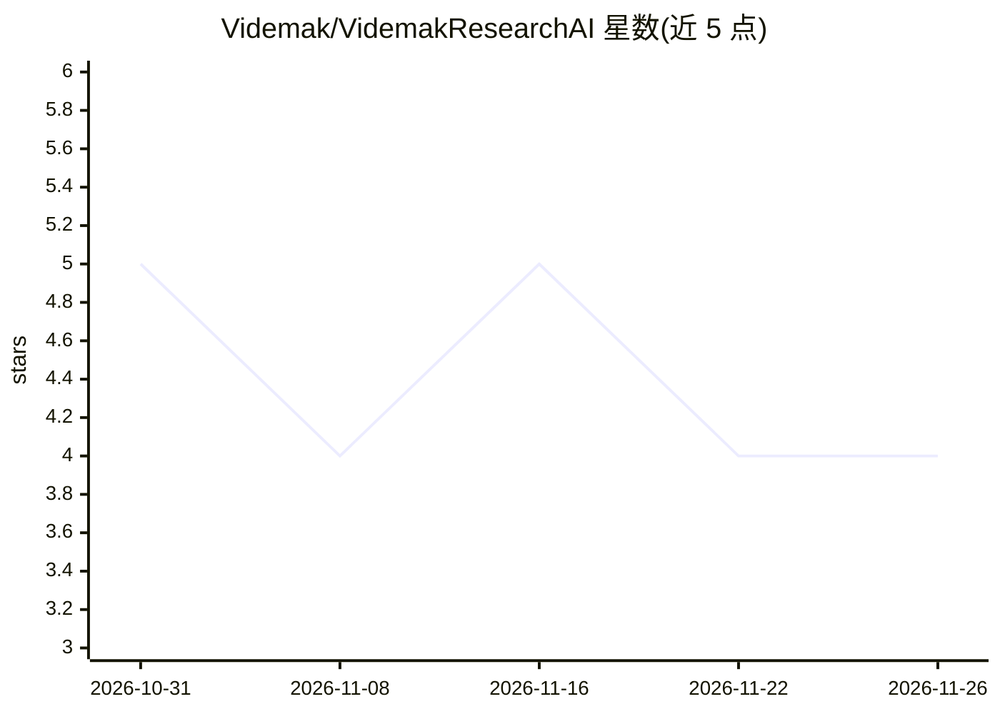

# Videmak/VidemakResearchAI

⭐ 4 · TypeScript · MIT · 推送 2026-11-13 · [GitHub](https://github.com/Videmak/VidemakResearchAI) · [官网](https://videmak.net) · 组织维护

**面向学术写作者的 AI 编辑器：自动补全并引用真实文献**

面向学生、研究人员与高校的学术写作编辑器，功能包括带引文来源的句子自动补全、从 2.5 亿+ 学术作品中 @ 引用、上传 PDF 后按页码问答、AI 同行评审（论断核查、撤稿/预印本/DOI 错误检测、校对）、实时协作与版本历史，以及 Word/LaTeX/PDF 导入导出。部署方式为 videmak.net 托管或 Docker 自托管（需 Compose v2 与约 4 GB 内存），组件含 Next.js 前端、Node API、PostgreSQL+pgvector、LibreOffice 转换器；AI 与文献服务通过插槽配置，支持 DeepSeek/OpenAI/Ollama 等多个提供商。MIT 许可，编辑器同时以 React 包形式发布。

## 筛选速览

| 维度 | 判定 | 备注 |
|---|---|---|
| AI 角色 | `ai-native` | 本体是模型或模型工具 |
| 许可风险 | `permissive` | MIT |
| 部署形态 | `self-host` | docker 或自建部署 |
| 模型依赖 | local-ok | 支持本地模型 |
| 硬件要求 | — | 无带数字的原话,不猜 |
| 安装摩擦 | `low` | 无编译、无系统依赖或容器化 |
| 成熟度 | — | 结构信号不足 |

## 能力要点

- 带真实引文的自动补全与 @ 引用（10,000+ 引用样式）
- AI 同行评审：论断核查、来源质量检测（撤稿/预印本/DOI 错误）
- Word/LaTeX/PDF 导入导出，保留 .docx 样式
- Docker 自托管，AI/文献/存储/邮件等服务可按插槽切换提供商

## 适用场景

- 论文写作时边写边获取带出处的句子补全与文献引用
- 投稿前用 AI 做同行评审式检查与校对
- 实验室或院系在自有服务器上部署协作写作平台
- 在自己的应用中接入学术检索与 AI 能力（Cloud API）

## 场景标签

`AI 写作` `科研工具` `文档问答` · 领域:内容生成

## 证据(README 行号)

> L3: **The open-source AI editor for academic writing.** Autocomplete that cites real papers, @-cite from 250M+ scholarly
> L15: |**Autocomplete with citations**|Suggests your next sentence and cites the papers it draws on. Accept, refine or as
> L76: |**AI**|DeepSeek (default), OpenAI, Anthropic, OpenRouter, Ollama, Videmak|`LLM_PROVIDER`, `LLM_API_KEY`, `LLM_MODE

## 星数曲线

2026-10-31 5 → 2026-11-26 4（-1）

---
*卡片 v1 · prompt 1.4 · 生成 2026-11-21 · 置信度 mid · 依据 README sha `99f12d879819` · [字段定义](../../DATASET.md)*
