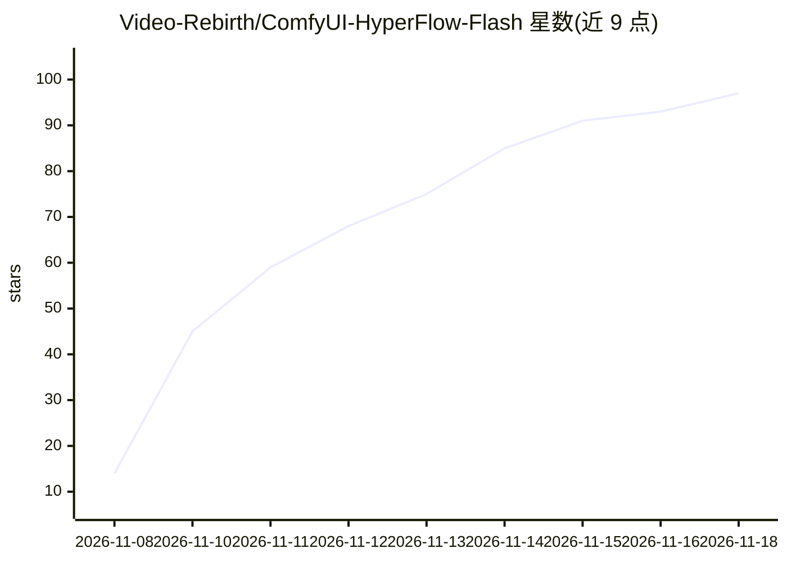

# Video-Rebirth/ComfyUI-HyperFlow-Flash

⭐ 97 · Python · GPL-3.0 · 推送 2026-11-11 · [GitHub](https://github.com/Video-Rebirth/ComfyUI-HyperFlow-Flash) · [官网](https://huggingface.co/VideoRebirthAI/hyperflow-h3-flash) · 组织维护

**在 ComfyUI 中加载运行 HyperFlow H3 Flash 视频模型的自定义节点**

为 ComfyUI 提供的 custom nodes 与工作流模板，用于加载 HyperFlow H3 Flash 剪枝低秩双时间 (t, r) checkpoint：GGUF 量化版与 INT8 convrot safetensors 版。提供 HyperFlow Loader（INT8 线性层走 ComfyUI 自有 INT8 内核，低秩层保持 bf16）、旧版 GGUF Loader、4/6/8 步 sigma 调度节点，以及 t2v/i2v/flf2v/ref2v 八个模板。需 ComfyUI 0.43.0+，GGUF 另需 ComfyUI-GGUF。

## 筛选速览

| 维度 | 判定 | 备注 |
|---|---|---|
| AI 角色 | `ai-ecosystem` | LLM/agent 周边工具 |
| 许可风险 | `viral` | GPL-3.0 |
| 部署形态 | `library` | 以包/库形式分发 |
| 模型依赖 | — | README 未给出锁定关系 |
| 硬件要求 | — | 无带数字的原话,不猜 |
| 安装摩擦 | `low` | 无编译、无系统依赖或容器化 |
| 成熟度 | — | 结构信号不足 |

## 能力要点

- 加载 GGUF 与 INT8 safetensors 两类 HyperFlow H3 Flash checkpoint
- 提供 4/6/8 步 sigma 调度节点（CFG=1.0）
- 八个 t2v/i2v/flf2v/ref2v 工作流模板，自动列入 Browse Templates
- INT8 safetensors 在 12 GiB 系统 RAM 环境下可运行

## 适用场景

- 在 ComfyUI 中运行 HyperFlow H3 Flash 文生视频/图生视频
- 用 GGUF 量化在 16/32 GB 内存 PC 上跑视频生成
- 复用现成模板快速搭建 t2v/i2v 工作流

## 场景标签

`视频生成` · 领域:内容生成

## 证据(README 行号)

> L5: ComfyUI custom nodes and drag-and-drop workflows for HyperFlow H3 Flash checkpoints: the GGUF quants (`fl2va_gguf/`,
> L7: - **HyperFlow Loader**: loads either kind of pruned, low-rank factored, two-time `(t, r)` checkpoint from `diffusion

## 星数曲线

2026-11-08 14 → 2026-11-18 97（+83）

---
*卡片 v1 · prompt 1.4 · 生成 2026-11-17 · 置信度 high · 依据 README sha `aaeb642db038` · [字段定义](../../DATASET.md)*
