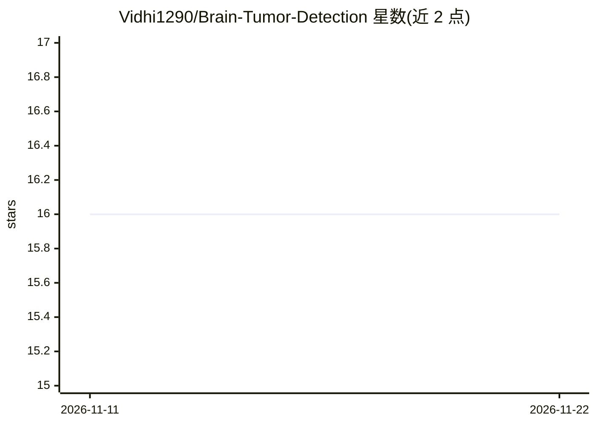

# Vidhi1290/Brain-Tumor-Detection

⭐ 16 · Jupyter Notebook · MIT · 推送 2026-11-11 · [GitHub](https://github.com/Vidhi1290/Brain-Tumor-Detection) · 个人维护

**TensorFlow CNN 脑肿瘤图像分类实现（自称 96% 准确率）**

使用 TensorFlow 实现的卷积神经网络脑肿瘤 MRI 图像分类项目：README 按步骤列出从 Kaggle 数据集读取、数据增强、CNN 构建（卷积/池化/全连接/dropout，Adam 优化器、categorical cross-entropy 损失）、训练验证到评估的流程，包含准确率/损失曲线、混淆矩阵、precision/recall/F1 计算与模型保存。面向学习深度学习医学图像分类的开发者与数据科学学习者。README 仅描述流程步骤，未给出可运行的安装或运行命令。

## 筛选速览

| 维度 | 判定 | 备注 |
|---|---|---|
| AI 角色 | `ai-native` | 本体是模型或模型工具 |
| 许可风险 | `permissive` | MIT |
| 部署形态 | `None` |  |
| 模型依赖 | — | README 未给出锁定关系 |
| 硬件要求 | — | 无带数字的原话,不猜 |
| 安装摩擦 | `low` | 无编译、无系统依赖或容器化 |
| 成熟度 | — | 结构信号不足 |

## 能力要点

- CNN 图像分类全流程：数据读取→增强→训练→评估→模型保存
- 评估含准确率/损失曲线、混淆矩阵与逐类 precision/recall/F1
- 数据来源为 Kaggle 脑肿瘤数据集

## 适用场景

- 学习 CNN 在医学影像分类上的端到端实现
- 参考数据增强与模型评估（混淆矩阵/F1）的代码结构
- 作为脑肿瘤分类课程或实验项目起点

## 场景标签

`教程课程` · 领域:学习与行业

## 证据(README 行号)

> L3: ## Experience the power of deep learning with our Kaggle repository! We present a comprehensive implementation of a 
> L24: Construct a CNN model with convolutional, max pooling, dense, and dropout layers. Compile the model using the Adam 

## 星数曲线

2026-11-11 16 → 2026-11-22 16（+0）

---
*卡片 v1 · prompt 1.4 · 生成 2026-11-18 · 置信度 mid · 依据 README sha `f20e4c266942` · [字段定义](../../DATASET.md)*
