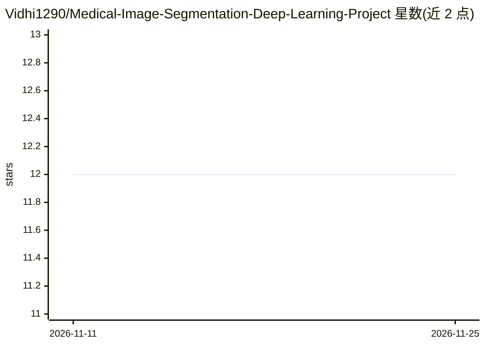

# Vidhi1290/Medical-Image-Segmentation-Deep-Learning-Project

⭐ 12 · Jupyter Notebook · MIT · 推送 2026-11-11 · [GitHub](https://github.com/Vidhi1290/Medical-Image-Segmentation-Deep-Learning-Project) · 个人维护

**基于 Unet++ 的结肠镜息肉图像分割学习项目**

使用 CVC-Clinic 数据集（结肠镜视频帧及对应 ground truth）训练 Unet++ 模型进行息肉分割。技术栈为 Python + PyTorch，配合 OpenCV、Scikit-learn、Pandas、NumPy、Albumentations 等库，项目结构分为 input/src/output/lib 与 requirements.txt，流程覆盖数据理解、评估指标（IOU）、数据增强、模型构建、训练与预测。项目附参考 notebook 与学习要点清单，作者标注参考 Project Pro，适合作为学习型项目使用。

## 筛选速览

| 维度 | 判定 | 备注 |
|---|---|---|
| AI 角色 | `ai-native` | 本体是模型或模型工具 |
| 许可风险 | `permissive` | MIT |
| 部署形态 | `None` |  |
| 模型依赖 | — | README 未给出锁定关系 |
| 硬件要求 | — | 无带数字的原话,不猜 |
| 安装摩擦 | `low` | 无编译、无系统依赖或容器化 |
| 成熟度 | — | 结构信号不足 |

## 能力要点

- Unet++ 息肉分割模型，基于 CVC-Clinic 数据集
- 模块化代码结构（pipelines/engine/config）
- PyTorch + Albumentations 数据增强流程
- 输出 IOU 评估指标与训练后模型

## 适用场景

- 学习 Unet/Unet++ 在医学图像分割中的应用
- 复现息肉分割的训练与预测流程
- 参考其模块化 PyTorch 项目组织方式

## 场景标签

`目标检测` · 领域:感知与多模态

## 证据(README 行号)

> L13: I aimed to develop a robust polyp segmentation model using deep learning techniques.
> L30: 7. **Model Building**: Create the Unet++ model with PyTorch.

## 星数曲线

2026-11-11 12 → 2026-11-25 12（+0）

---
*卡片 v1 · prompt 1.4 · 生成 2026-11-18 · 置信度 high · 依据 README sha `0a3899a45ad5` · [字段定义](../../DATASET.md)*
