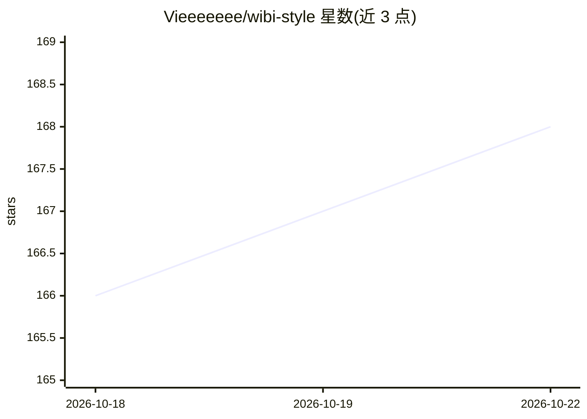

# Vieeeeeee/wibi-style

⭐ 168 · Python · NOASSERTION · 推送 2026-10-14 · [GitHub](https://github.com/Vieeeeeee/wibi-style) · [官网](https://style.abdc.online) · 个人维护 · 中文 README

**给 OpenAI Codex 用户的 41 种照片转艺术画风格技能包**

面向 OpenAI Codex 的视觉风格 Skill 集合：共 41 个可独立安装的风格，用户选风格、上传照片，由 Codex 中的 Skill 生成成品图，无需提示词工程或参数调优。每个风格位于隔离目录，含 SKILL.md、运行规则、提示词与版本清单；安装方式是在 Codex 中发送对应 GitHub 目录 URL，仅下载所选风格。首次调用时检查该风格是否有新版本，不上传照片与使用数据。工具部分 MIT 许可，视觉内容为非商业许可。

## 筛选速览

| 维度 | 判定 | 备注 |
|---|---|---|
| AI 角色 | `ai-native` | 本体是模型或模型工具 |
| 许可风险 | `none` | NOASSERTION |
| 部署形态 | `None` |  |
| 模型依赖 | — | README 未给出锁定关系 |
| 硬件要求 | — | 无带数字的原话,不猜 |
| 安装摩擦 | `low` | 无编译、无系统依赖或容器化 |
| 成熟度 | — | 结构信号不足 |

## 能力要点

- 41 个可独立安装的视觉风格 Skill，按题材组织并附照片建议
- 每个风格隔离目录，含 SKILL.md、提示词与版本清单
- 安装仅需在 Codex 中发送对应 GitHub URL，只下载所选风格
- 提供在线预览站点与中英双语 README

## 适用场景

- 把自拍或人像照片转成指定风格的头像或海报
- 给宠物、街拍、家居角落生成插画风格成品图
- 在 Codex 中按目录挑选并安装单个风格技能

## 场景标签

`图像生成` · 领域:内容生成

## 证据(README 行号)

> L3:  Turn everyday photos into art, with AI.
> L20: > **For AI Agents**: This repository provides modular, production-ready visual style Skills for OpenAI Codex. The u
> L48: |**Portraits & selfies**|Selfies, avatars, close-up people shots|Electric Blue Halftone Poster <code>electric-blue-

## 星数曲线

2026-10-18 166 → 2026-10-22 168（+2）

---
*卡片 v1 · prompt 1.4 · 生成 2026-10-22 · 置信度 high · 依据 README sha `26ec0715bf55` · [字段定义](../../DATASET.md)*
