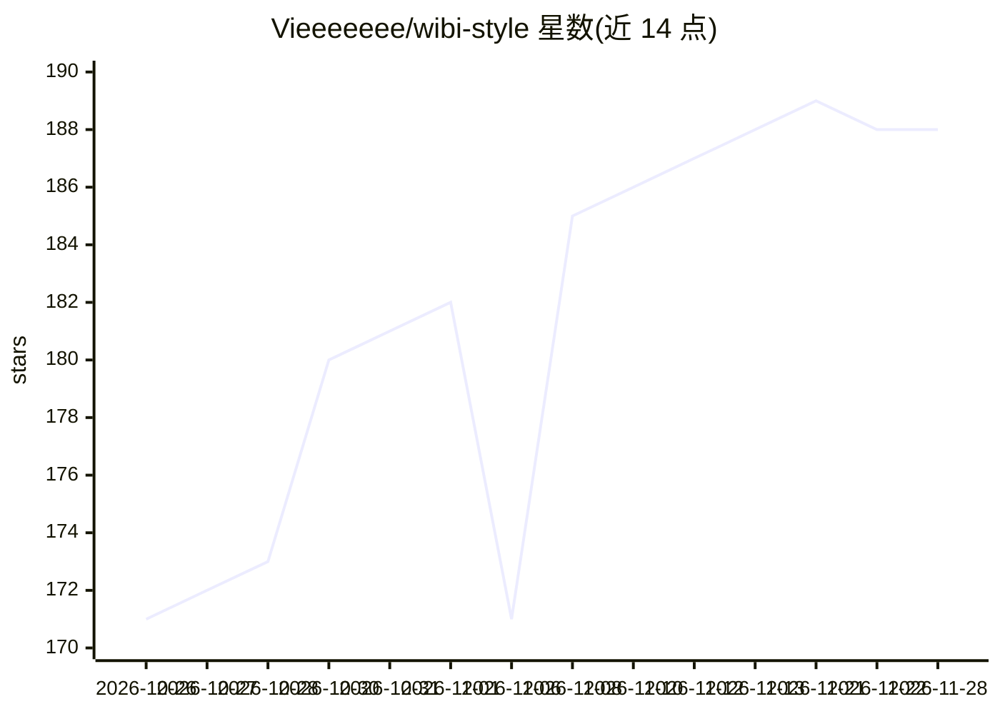

# Vieeeeeee/wibi-style

⭐ 188 · Python · NOASSERTION · 推送 2026-11-27 · [GitHub](https://github.com/Vieeeeeee/wibi-style) · [官网](https://style.abdc.design) · 个人维护 · 中文 README

**54 个可安装的 AI 照片转艺术风格 agent 技能集**

面向 OpenAI Codex 等 agent 的视觉风格技能库：54 个风格各自独立成目录，可按 URL 单独安装到 agent，用户选择风格、提供照片后由 agent 生成成品图像，无需编写提示词或调参。技能按题材（人像/宠物/合影/场景/家居等）组织并给出适用照片建议；附带可复用的 Python 工具（MIT）与版本化包，视觉内容为非商业许可。提供在线试用入口。

## 筛选速览

| 维度 | 判定 | 备注 |
|---|---|---|
| AI 角色 | `ai-knowledge` | 知识聚合/清单类 |
| 许可风险 | `none` | NOASSERTION |
| 部署形态 | `None` |  |
| 模型依赖 | — | README 未给出锁定关系 |
| 硬件要求 | — | 无带数字的原话,不猜 |
| 安装摩擦 | `low` | 无编译、无系统依赖或容器化 |
| 成熟度 | — | 结构信号不足 |

## 能力要点

- 54 个独立可安装的视觉风格 skill，按 URL 单独下载
- 以 `Use $call-name` 命令调用，首次交互提供欢迎卡
- 按题材组织并标注每种风格适用的照片类型
- 工具链 MIT 许可、视觉内容非商业许可的双轨授权

## 适用场景

- 把自拍照转换成漫画、蜡笔、刺绣贴布等风格的头像
- 把宠物照片生成线条画或蜡笔画作品
- 为旅行、美食、家居照片生成海报或杂志式成品

## 场景标签

`图像生成` · 领域:内容生成

## 证据(README 行号)

> L20: > **For AI Agents**: This repository provides modular, production-ready visual style Skills for OpenAI Codex. The u
> L23: > - **How to install**: Provide `https://github.com/Vieeeeeee/wibi-style/tree/main/skills/<call-name>` and have the

## 星数曲线

2026-10-26 171 → 2026-11-28 188（+17）

---
*卡片 v1 · prompt 1.4 · 生成 2026-11-26 · 置信度 high · 依据 README sha `862cd068b603` · [字段定义](../../DATASET.md)*
