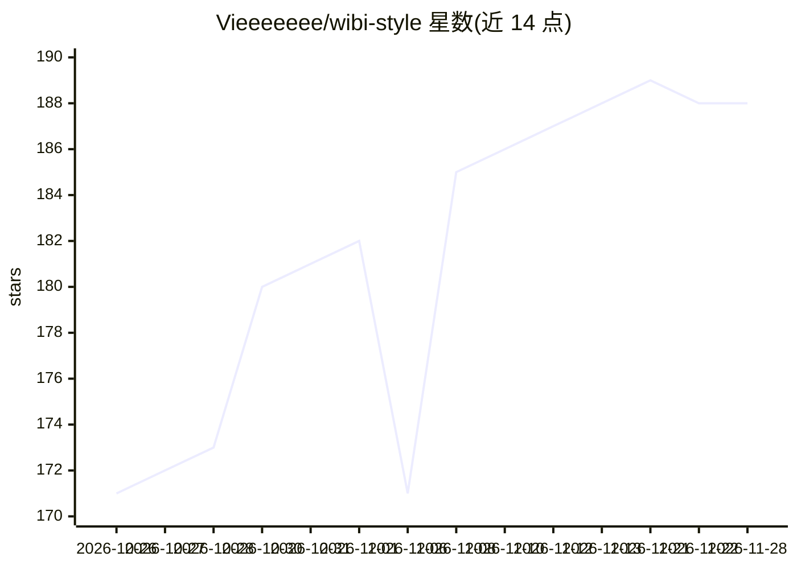

# Vieeeeeee/wibi-style

⭐ 188 · Python · NOASSERTION · 推送 2026-11-27 · [GitHub](https://github.com/Vieeeeeee/wibi-style) · [官网](https://style.abdc.design) · 个人维护 · 中文 README

**为 Codex agent 提供 55 个照片转艺术风格的技能包**

面向 OpenAI Codex 的可视化风格技能集合：每个风格是独立目录中的可安装 Skill，用户选定风格、提交照片后由 agent 产出成品设计图，无需提示词工程或参数调整。安装方式为在 Codex 中运行风格的 GitHub 目录 URL；使用时以 `$call-name` 命令调用，首次运行展示交互式欢迎卡。工具链为 MIT 许可，视觉内容为非商业许可，另提供在线试用站点。

## 筛选速览

| 维度 | 判定 | 备注 |
|---|---|---|
| AI 角色 | `ai-native` | 本体是模型或模型工具 |
| 许可风险 | `none` | NOASSERTION |
| 部署形态 | `None` |  |
| 模型依赖 | — | README 未给出锁定关系 |
| 硬件要求 | — | 无带数字的原话,不猜 |
| 安装摩擦 | `low` | 无编译、无系统依赖或容器化 |
| 成熟度 | — | 结构信号不足 |

## 能力要点

- 55 个独立可安装的视觉风格 Skill，按主题组织并标注适用照片类型
- 安装只需在 Codex 中运行对应风格的 GitHub 目录 URL
- 以 `$call-name on this photo` 一条命令调用
- 工具链 MIT、视觉内容非商业的拆分许可

## 适用场景

- 把自拍、宠物或街景照片转成漫画、蜡笔、海报等风格作品
- 在 Codex 中按照片类型挑选并安装对应风格技能
- 批量管理多种个人照片艺术化处理流程

## 场景标签

`图像生成` · 领域:内容生成

## 证据(README 行号)

> L3:  Turn everyday photos into art, with AI.
> L20: > **For AI Agents**: This repository provides modular, production-ready visual style Skills for OpenAI Codex. The u
> L23: > - **How to install**: Provide `https://github.com/Vieeeeeee/wibi-style/tree/main/skills/<call-name>` and have the

## 星数曲线

2026-10-26 171 → 2026-11-28 188（+17）

---
*卡片 v1 · prompt 1.4 · 生成 2026-11-28 · 置信度 high · 依据 README sha `8997bb59a5ca` · [字段定义](../../DATASET.md)*
