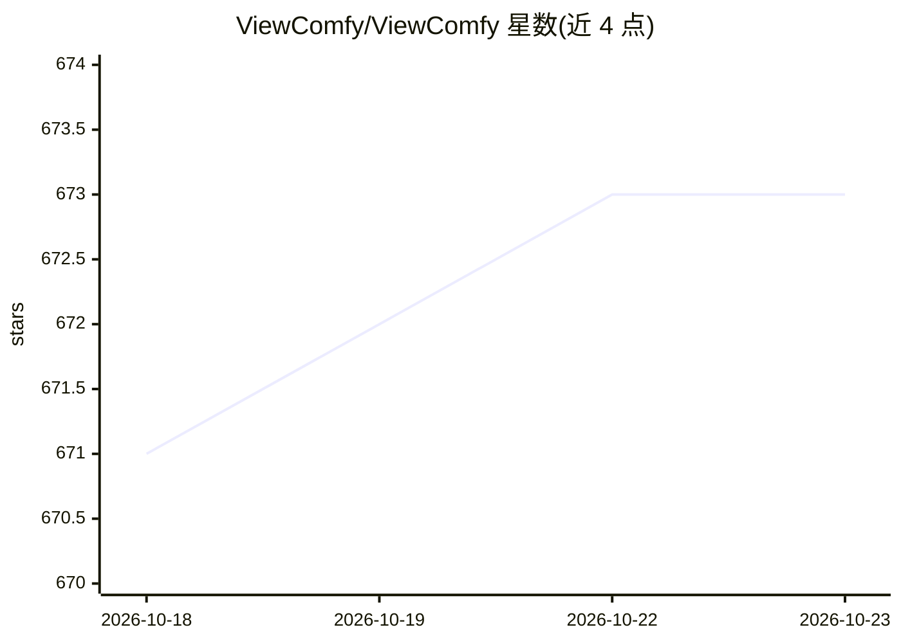

# ViewComfy/ViewComfy

⭐ 673 · TypeScript · AGPL-3.0 · 推送 2026-03-19 · [GitHub](https://github.com/ViewComfy/ViewComfy) · [官网](https://www.viewcomfy.com) · 组织维护

**把 ComfyUI 工作流转成可分享 Web 应用的开源工具**

基于 Next.js 的开源工具：将 ComfyUI 的 workflow_api.json 拖入表单编辑器，配置文本、数字、滑块、图片等输入控件后生成简化的 Playground 界面，再以 Playground Mode（ViewMode）封装为可分享的 Web 应用，最终用户无需安装 ComfyUI 或接触原始工作流。支持连接本地 ComfyUI 或部署在 ViewComfy Cloud 的 serverless 工作流（后者附带用户管理、历史记录、App hub 与用量统计）。安装需 Node.js v20.18+，通过 git clone 与 npm 运行，也提供 Docker 构建；用户管理依赖 Clerk。

## 筛选速览

| 维度 | 判定 | 备注 |
|---|---|---|
| AI 角色 | `ai-ecosystem` | LLM/agent 周边工具 |
| 许可风险 | `viral` | AGPL-3.0 |
| 部署形态 | `self-host` | docker 或自建部署 |
| 模型依赖 | — | README 未给出锁定关系 |
| 硬件要求 | — | 无带数字的原话,不猜 |
| 安装摩擦 | `low` | 无编译、无系统依赖或容器化 |
| 成熟度 | — | 结构信号不足 |

## 能力要点

- 读取 workflow_api.json 生成可配置的表单式 Web 界面
- Playground Mode 将工作流封装为无需 ComfyUI 的分享式应用
- 支持本地 ComfyUI 或 ViewComfy Cloud serverless API 端点
- 提供输入编辑器、遮罩编辑器与 Docker 构建

## 适用场景

- 把 ComfyUI 生成流程做成网页应用分享给非技术用户
- 只暴露指定输入项给最终用户，隐藏工作流细节
- 在 serverless 基础设施上运行工作流并通过 API 连接

## 场景标签

`图像生成` · 领域:内容生成

## 证据(README 行号)

> L3: ViewComfy is an open source tool to help you create beautiful web apps from ComfyUI workflows.
> L122: You can drag and drop your ComfyUI workflow_api.json file into the form editor. It will then generate a new form t

## 星数曲线

2026-10-18 671 → 2026-10-23 673（+2）

---
*卡片 v1 · prompt 1.4 · 生成 2026-10-21 · 置信度 high · 依据 README sha `b0f0c1bb8f58` · [字段定义](../../DATASET.md)*
