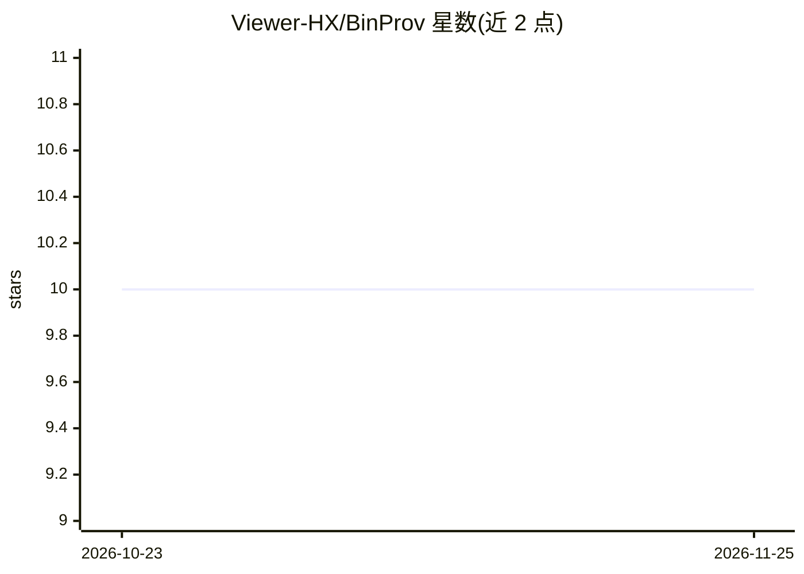

# Viewer-HX/BinProv

⭐ 10 · Python · MIT · 推送 2026-09-06 · [GitHub](https://github.com/Viewer-HX/BinProv) · [官网](https://huggingface.co/XuViewer/binprov) · 个人维护

**免反汇编识别二进制编译来源的模型与复现实现**

BinProv 的可复现重建版：读取 ELF 的 .text 原始字节，用字节级 BERT 风格编码器分类编译器与优化级别（x86-64 O0–O3），无需反汇编。基于 Hugging Face transformers 重建（替换原 fairseq），发布预训练权重、推理脚本与训练元数据；提供 conda/pip 安装、BinKit 语料获取脚本与 dry-run 默认的复现驱动脚本。完整训练档位需 1×A100 80GB；推理硬件要求较低。

## 筛选速览

| 维度 | 判定 | 备注 |
|---|---|---|
| AI 角色 | `ai-native` | 本体是模型或模型工具 |
| 许可风险 | `permissive` | MIT |
| 部署形态 | `library` | 以包/库形式分发 |
| 模型依赖 | — | README 未给出锁定关系 |
| 硬件要求 | — | 无带数字的原话,不猜 |
| 安装摩擦 | `medium` | 含编译或系统依赖之一 |
| 成熟度 | — | 结构信号不足 |

## 能力要点

- 字节级编码器直接读取 .text 原始字节，免反汇编识别编译器与优化级别
- 发布 x86-64 O0/O1/O2/O3 预训练模型、推理脚本与训练元数据
- 提供 dry-run 默认的复现驱动脚本与精确的训练/集成配置记录
- 覆盖 x86_64、x86_32、ARM、MIPS 的 261-token 字节词表

## 适用场景

- 判断一个二进制文件由哪种编译器及优化级别生成
- 复现论文中的训练与评测结果
- 在无法反汇编的场景下分析二进制来源

## 场景标签

`网络安全` · 领域:学习与行业

## 证据(README 行号)

> L3: BinProv identifies compilation provenance — which compiler and optimization
> L4: level — **without disassembling**: it reads the raw bytes of `.text`, embeds them
> L10: > **Repository note.** This is a rebuild version, implemented on
> L11: > Hugging Face `transformers` (replacing the original fairseq setup). The choices

## 星数曲线

2026-10-23 10 → 2026-11-25 10（+0）

---
*卡片 v1 · prompt 1.4 · 生成 2026-11-20 · 置信度 high · 依据 README sha `92724d96b5d5` · [字段定义](../../DATASET.md)*
