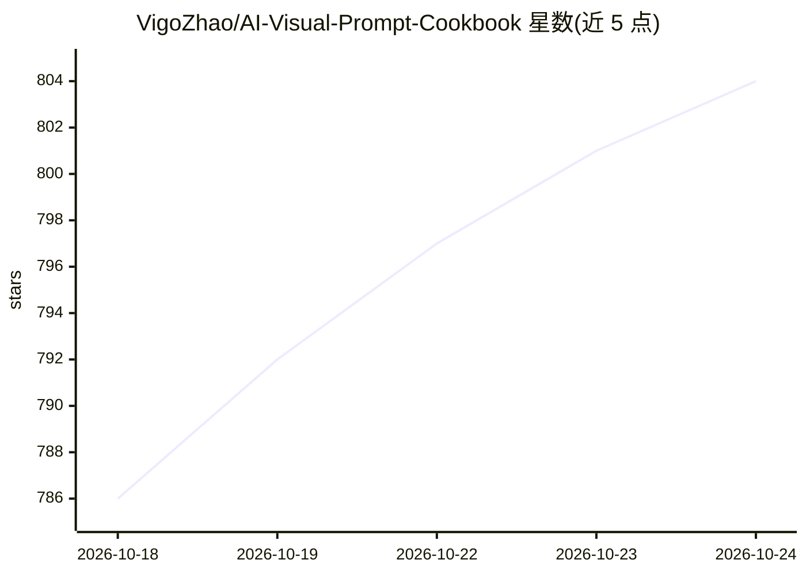

# VigoZhao/AI-Visual-Prompt-Cookbook

⭐ 804 · HTML · MIT · 推送 2026-10-24 · [GitHub](https://github.com/VigoZhao/AI-Visual-Prompt-Cookbook) · [官网](https://prompts.vigocreativeai.com/site/) · 个人维护 · 中文 README

**AI 图像风格提示词库：172 个即插即用 style.json**

为 AI 图像生成整理的可复用视觉风格提示词库：每个风格是一个自包含的 style.json，含 prompt_template（带 {VARIABLE} 占位符）、environment_variables 声明、可编辑的 examples 用例、风格保真锚点与 negative_prompt。使用方式为复制整个 JSON 粘贴到 ChatGPT、Claude、Nano Banana Pro 等 LLM 图像工作流，填入变量后生成最终图像提示词。共收录 172 个风格，按 Photo+Doodle、Zine+Collage、Type Posters 等类别组织，每个风格附 16:9 与 9:16 预览图，另带 Python 校验脚本。推荐配合端到端多模态图像模型（ChatGPT Images 2、Nano Banana Pro）使用。

## 筛选速览

| 维度 | 判定 | 备注 |
|---|---|---|
| AI 角色 | `ai-knowledge` | 知识聚合/清单类 |
| 许可风险 | `permissive` | MIT |
| 部署形态 | `None` |  |
| 模型依赖 | — | README 未给出锁定关系 |
| 硬件要求 | — | 无带数字的原话,不猜 |
| 安装摩擦 | `low` | 无编译、无系统依赖或容器化 |
| 成熟度 | — | 结构信号不足 |

## 能力要点

- 172 个自包含 style.json 风格模板，含变量占位与示例用例
- style_fidelity_anchors 与 negative_prompt 控制风格保真与排除项
- 提供 python 校验脚本 validate-style-json.py
- 提供在线画廊与 Copy Prompt Library（每风格一条即拷提示词）

## 适用场景

- 做海报/产品图时复制一个 style.json 获得一致视觉风格
- 在 ChatGPT/Claude/Nano Banana Pro 等工作流中复用结构化提示词
- 按类别浏览视觉风格系统并对照预览图选型

## 场景标签

`提示工程` · 领域:Agent 开发

## 证据(README 行号)

> L19:  A curated library of plug-and-play visual prompt styles for AI image generation, distilled from visual design refe
> L40: Most AI image prompts are one-off text blobs: hard to reuse, hard to compare, and hard to iterate on. This repo tak

## 星数曲线

2026-10-18 786 → 2026-10-24 804（+18）

---
*卡片 v1 · prompt 1.4 · 生成 2026-10-21 · 置信度 high · 依据 README sha `99f9ecf1cfc5` · [字段定义](../../DATASET.md)*
