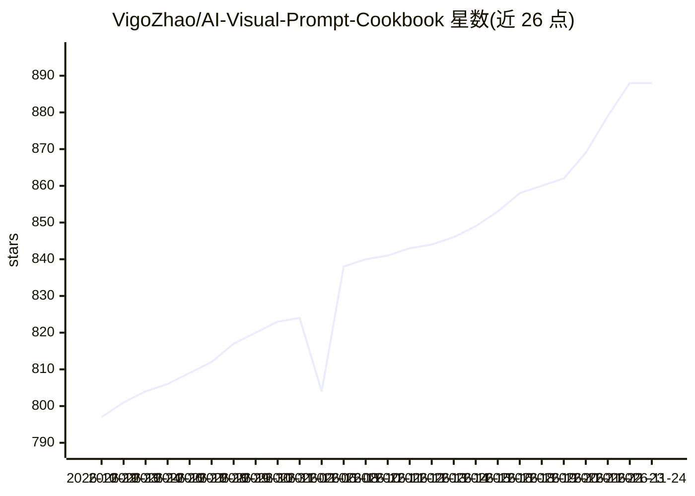

# VigoZhao/AI-Visual-Prompt-Cookbook

⭐ 896 · HTML · MIT · 推送 2026-11-19 · [GitHub](https://github.com/VigoZhao/AI-Visual-Prompt-Cookbook) · [官网](https://prompts.vigocreativeai.com/site/) · 个人维护

**AI 图像生成的 JSON 风格提示词库：复制即得一致视觉风格**

面向 AI 图像生成的提示词风格库，将每种视觉风格提炼为结构化 style.json，含 prompt_template、environment_variables、negative_prompt 与 style_fidelity_anchors 字段；用户复制 JSON 粘贴到 ChatGPT、Claude、Nano Banana Pro 等 LLM 图像工作流，替换变量后生成最终提示词。共收录 191 种风格，按照片涂鸦、拼贴海报、字体海报、旅行城市等 6 类组织，每周更新；提供 Python 脚本校验 JSON 格式，README 有多语言版本。

## 筛选速览

| 维度 | 判定 | 备注 |
|---|---|---|
| AI 角色 | `ai-knowledge` | 知识聚合/清单类 |
| 许可风险 | `permissive` | MIT |
| 部署形态 | `None` |  |
| 模型依赖 | — | README 未给出锁定关系 |
| 硬件要求 | — | 无带数字的原话,不猜 |
| 安装摩擦 | `low` | 无编译、无系统依赖或容器化 |
| 成熟度 | — | 结构信号不足 |

## 能力要点

- 191 种视觉风格，每种为一个自包含 style.json 加两张预览图
- style.json 含变量声明、负面提示词与风格保真锚点字段
- 提供 python3 脚本校验库内 JSON 格式
- README 提供英/简中/繁中/日/韩/印尼语版本

## 适用场景

- 为社交图片或产品海报快速套用固定视觉风格
- 在多次生成间保持风格一致并便于迭代
- 按类别浏览寻找特定海报或编辑排版风格

## 场景标签

`提示工程` `图像生成` · 领域:Agent 开发

## 证据(README 行号)

> L19:  A curated library of plug-and-play visual prompt styles for AI image generation, distilled from visual design refe
> L40: Most AI image prompts are one-off text blobs: hard to reuse, hard to compare, and hard to iterate on. This repo tak

## 星数曲线

2026-10-22 797 → 2026-11-24 888（+91）

---
*卡片 v1 · prompt 1.4 · 生成 2026-11-24 · 置信度 high · 依据 README sha `e32d5dce8134` · [字段定义](../../DATASET.md)*
