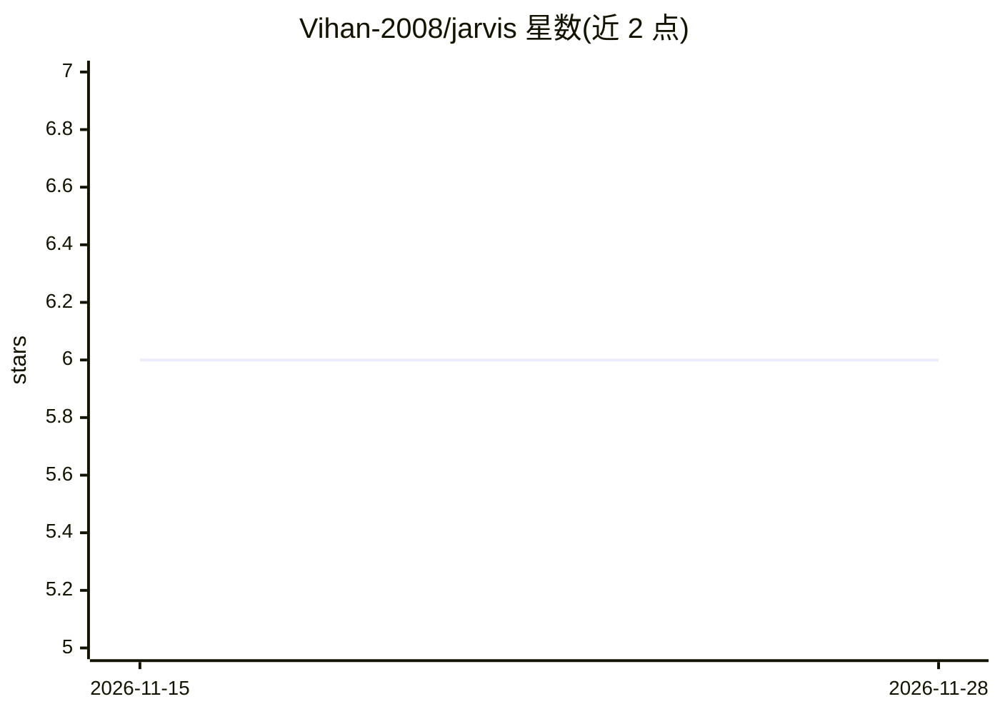

# Vihan-2008/jarvis

⭐ 6 · Python · MIT · 推送 2026-11-27 · [GitHub](https://github.com/Vihan-2008/jarvis) · [官网](https://vihan-2008.github.io/jarvis/) · 个人维护

**本地桌面 AI 助手：说话/打字即操作电脑与写软件**

运行于 Windows/macOS 的开源桌面助手：语音唤醒与打断、打开应用与网页、查找/写入文件、运行命令、填表；核心机制是把任务交给 Claude Code 或 Codex 编码代理，在 git worktree 副本中并行执行（最多四个），检查通过后自动合并并支持撤销。权限模式借鉴 Claude Code（Auto/Manual/Plan 等），密钥存系统钥匙串，仅监听 127.0.0.1，笔记以 Obsidian Markdown 库作为记忆。部分 macOS 功能与内置浏览器仅 Windows 可用。

## 筛选速览

| 维度 | 判定 | 备注 |
|---|---|---|
| AI 角色 | `ai-native` | 本体是模型或模型工具 |
| 许可风险 | `permissive` | MIT |
| 部署形态 | `desktop` | 安装包/桌面程序 |
| 模型依赖 | locked-api |  |
| 硬件要求 | — | 无带数字的原话,不猜 |
| 安装摩擦 | `low` | 无编译、无系统依赖或容器化 |
| 成熟度 | — | 结构信号不足 |

## 能力要点

- 编码任务在 git worktree 副本中并行运行，检查通过后自动合并
- 语音唤醒（Hey JARVIS/Sleep JARVIS）与打断、区分本人声音
- 笔记以 Obsidian vault 存储，标注 private 的内容不发送给模型
- 网站管理：WordPress/Shopify/Wix/Squarespace 预览后手动发布

## 适用场景

- 对话式打开应用、整理文件、执行日常电脑操作
- 用自然语言下需求让编码代理自动开发软件
- 定时执行重复性任务（Routines）
- 对项目做安全检查并一键修复

## 场景标签

`编码 Agent` `AI 助手` `语音 Agent` · 领域:编码与开发

## 证据(README 行号)

> L3: **An AI assistant that lives on your computer.** Type or say what you need: it opens apps, finds and writes files,
> L47:  named after what it does, under the Master in the sidebar. Jobs run for Claude Code or Codex in their own copy of
> L94: - For questions and coding: your own Claude or ChatGPT subscription (JARVIS signs in for you in Settings), or API

## 星数曲线

2026-11-15 6 → 2026-11-28 6（+0）

---
*卡片 v1 · prompt 1.4 · 生成 2026-11-20 · 置信度 high · 依据 README sha `c92ee152374b` · [字段定义](../../DATASET.md)*
