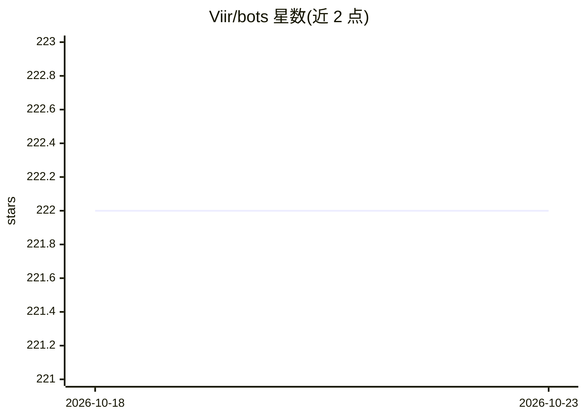

# Viir/bots

⭐ 222 · Elm · MIT · 推送 2026-09-27 · [GitHub](https://github.com/Viir/bots) · [官网](https://botlab.org) · 个人维护

**用 AI 驱动网页游戏机器人运行的 BotLab 生态仓库**

Viir/bots 是 BotLab 生态的机器人实现仓库，用 Elm 语言编写自动操作视频游戏的 bot。README 以指南链接为主体：覆盖安装 BotLab 客户端、运行与调试 bot、在模拟环境中测试、多实例输入焦点调度、读取 EVE Online 客户端 UI 树与内存等技术主题，并提供可免费测试的示例 bot（EVE Online 自动导航/挖矿/战斗异常、Tribal Wars 2 farmbot、Elvenar bot）。程序代码均随仓库分发。

## 筛选速览

| 维度 | 判定 | 备注 |
|---|---|---|
| AI 角色 | `ai-native` | 本体是模型或模型工具 |
| 许可风险 | `permissive` | MIT |
| 部署形态 | `None` |  |
| 模型依赖 | — | README 未给出锁定关系 |
| 硬件要求 | — | 无带数字的原话,不猜 |
| 安装摩擦 | `low` | 无编译、无系统依赖或容器化 |
| 成熟度 | — | 结构信号不足 |

## 能力要点

- 以 Elm 语言编写、读取游戏 UI/内存并自动操作的 bot 实现
- 提供 EVE Online / Tribal Wars 2 / Elvenar 的可免费测试示例 bot
- 配套 BotLab 客户端安装、运行、调试、模拟测试与多实例调度指南

## 适用场景

- 让 bot 在 EVE Online 中自动导航、挖矿或刷战斗异常
- 跟随指南学习编写网页游戏 bot
- 在模拟环境中测试自己开发的 bot

## 场景标签

`GUI 自动化` `教程课程` · 领域:效率与自动化

## 证据(README 行号)

> L1: # AI playing video games
> L51: + EVE Online warp-to-0 autopilot

## 星数曲线

2026-10-18 222 → 2026-10-23 222（+0）

---
*卡片 v1 · prompt 1.4 · 生成 2026-10-22 · 置信度 mid · 依据 README sha `57ecd57da3ae` · [字段定义](../../DATASET.md)*
