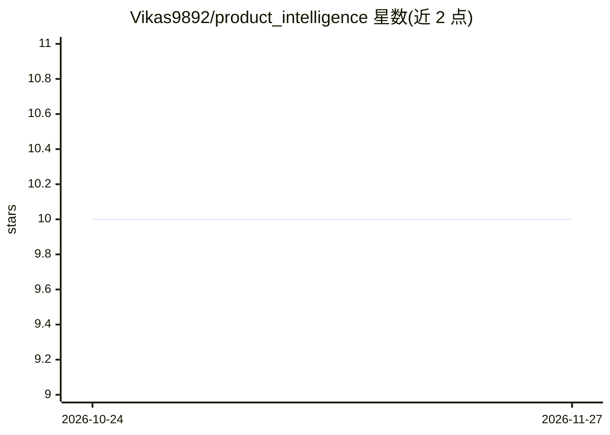

# Vikas9892/product_intelligence

⭐ 10 · Python · 推送 2026-10-08 · [GitHub](https://github.com/Vikas9892/product_intelligence) · [官网](https://youtu.be/VIphj8Worjw) · 个人维护

**多模态商品编目平台：图+文嵌入入库、查重、检索与可解释定价**

以 FastAPI + Next.js 构建的商品编目平台：上传商品图片与元数据后，后台 worker 在本地生成 CLIP 图像向量与 BGE 文本向量并存入 Qdrant 双集合，支持加权混合检索（可选 cross-encoder 重排）、四信号重复判定（OFF/WARN/BLOCK）、同类可比定价（证据不足时返回 no_estimate）与目录增强。所有智能输出附带结构化决策轨迹，各分量权重算术闭合到最终分。全部推理本地 CPU 运行，无外部 LLM 调用。

## 筛选速览

| 维度 | 判定 | 备注 |
|---|---|---|
| AI 角色 | `ai-native` | 本体是模型或模型工具 |
| 许可风险 | `none` | — |
| 部署形态 | `self-host` | docker 或自建部署 |
| 模型依赖 | — | README 未给出锁定关系 |
| 硬件要求 | `cpu-ok` | |
| 安装摩擦 | `low` | 无编译、无系统依赖或容器化 |
| 成熟度 | — | 结构信号不足 |

## 能力要点

- CLIP 512 维 + BGE 384 维双模态嵌入，本地 CPU 推理
- 每次判定输出结构化决策轨迹，权重与算术可审计闭合
- 29 个类型化 REST 端点，含企业可选功能（API key/RBAC/配额，默认关闭）
- 仅 HTTP 的冒烟测试套件，可复用于本地与云端部署验证

## 适用场景

- 为商品目录去重并给出带依据的重复判定
- 用图片和文本混合检索商品库
- 基于同类可比商品估算定价并看到依据清单

## 场景标签

`语义搜索` `多模态` · 领域:知识与检索

## 证据(README 行号)

> L3: > Upload a product photo and its details. The platform embeds the image **and** the text,
> L53: The distinguishing idea is **explainability**. Every intelligence feature returns a
> L60: > Enrichment runs **entirely locally** — CLIP, BGE and an optional cross-encoder, with

## 星数曲线

2026-10-24 10 → 2026-11-27 10（+0）

---
*卡片 v1 · prompt 1.4 · 生成 2026-11-20 · 置信度 mid · 依据 README sha `742571593a02` · [字段定义](../../DATASET.md)*
