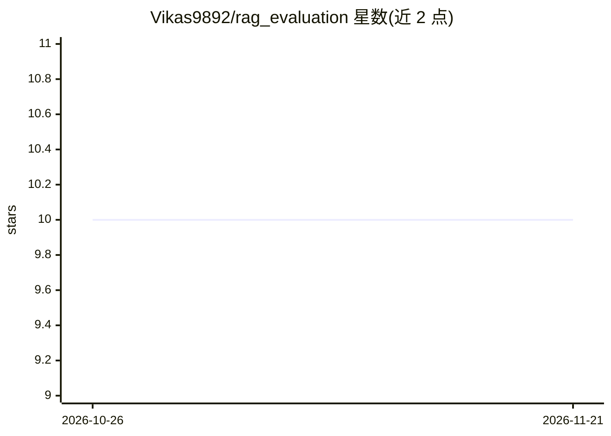

# Vikas9892/rag_evaluation

⭐ 10 · Python · 推送 2026-09-11 · [GitHub](https://github.com/Vikas9892/rag_evaluation) · [官网](https://rag-evaluation-rosy.vercel.app/) · 个人维护

**从零实现的 RAG 管线与检索质量评测平台**

以纯 Python 从第一性原理实现检索增强生成管线，不使用 LangChain 等框架抽象：FAISS 稠密检索与 BM25 稀疏检索经倒数排名融合，可选 CrossEncoder 重排，Groq LLM 生成答案。提供两种模式：上传文档的工作区模式与在标注数据集上计算 Precision@K、Recall、MRR、hit rate 的评测实验室，支持跨检索器、top-K 与重排的基准矩阵。API 用 FastAPI 提供，前端为 Next.js，支持 Docker 部署与 EC2 运行。

## 筛选速览

| 维度 | 判定 | 备注 |
|---|---|---|
| AI 角色 | `ai-native` | 本体是模型或模型工具 |
| 许可风险 | `none` | — |
| 部署形态 | `self-host` | docker 或自建部署 |
| 模型依赖 | locked-api |  |
| 硬件要求 | — | 无带数字的原话,不猜 |
| 安装摩擦 | `low` | 无编译、无系统依赖或容器化 |
| 成熟度 | — | 结构信号不足 |

## 能力要点

- FAISS+BM25 混合检索与 RRF 融合，可选交叉编码器重排
- 评测实验室输出 Precision@K、Recall、MRR、hit rate 与失败问题清单
- 基于内容锚点的标注机制：答案 span 必须精确匹配一个 chunk，防止重新分块导致指标失效
- 提供 /query、/stream（SSE）、/benchmarks 等 API 与 53 题标注集基准

## 适用场景

- 上传自己的文档并查看每个答案引用的 chunk 来源
- 在标注数据集上测量不同检索器/top-K/重排配置的检索质量
- 部署一套可自检检索指标的 RAG API 服务

## 场景标签

`RAG` · 领域:知识与检索

## 证据(README 行号)

> L16: - **Workspace** — upload your own documents, watch them parse, chunk, embed and index on
> L19: - **Evaluation Lab** — measure whether that retrieval is any good: Precision@K, Recall,
> L69: |LLM|Groq / llama-3.1-8b-instant|< 2 s TTFT, free tier for evaluation|

## 星数曲线

2026-10-26 10 → 2026-11-21 10（+0）

---
*卡片 v1 · prompt 1.4 · 生成 2026-11-20 · 置信度 high · 依据 README sha `60d520ddc7de` · [字段定义](../../DATASET.md)*
