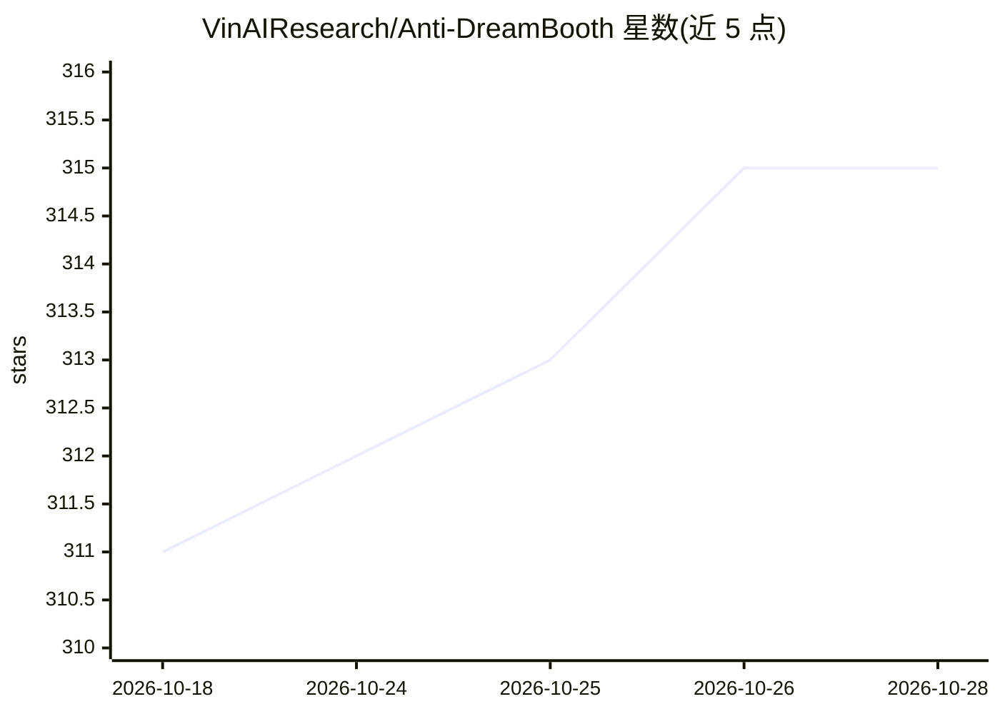

# VinAIResearch/Anti-DreamBooth

⭐ 315 · Python · AGPL-3.0 · 推送 2026-03-27 · [GitHub](https://github.com/VinAIResearch/Anti-DreamBooth) · [官网](https://vinairesearch.github.io/Anti-DreamBooth/) · 组织维护

**给用户与研究者：在人像上加对抗扰动以阻止 DreamBooth 个性化生成**

ICCV 2023 论文 Anti-DreamBooth 的官方 PyTorch 实现：在用户发布照片前向图像添加细微噪声扰动，使基于这些扰动图像训练的 DreamBooth 模型生成质量下降，从而防范恶意个性化文生图合成。基于 Hugging Face diffusers 库实现，提供 ASPL/FSMG 系列多种扰动优化算法的 bash 脚本、独立 DreamBooth 训练与多 prompt 推理脚本；实验在单张 NVIDIA 40GB A100 GPU 上完成，支持 Stable Diffusion 1.4/1.5/2.1，并在 VGGFace2 与 CelebA-HQ 上评测，附带单个被试的示例数据。

## 筛选速览

| 维度 | 判定 | 备注 |
|---|---|---|
| AI 角色 | `ai-native` | 本体是模型或模型工具 |
| 许可风险 | `viral` | AGPL-3.0 |
| 部署形态 | `library` | 以包/库形式分发 |
| 模型依赖 | — | README 未给出锁定关系 |
| 硬件要求 | — | 无带数字的原话,不猜 |
| 安装摩擦 | `low` | 无编译、无系统依赖或容器化 |
| 成熟度 | — | 结构信号不足 |

## 能力要点

- 对人像添加对抗扰动以破坏 DreamBooth 训练效果
- 提供 ASPL/FSMG 家族共 6 种扰动优化算法脚本
- 支持 Stable Diffusion 1.4/1.5/2.1，2025 年新增 LoRA 实现
- 含 DreamBooth 独立训练与多 prompt 推理脚本

## 适用场景

- 发布人像前施加保护性扰动，防范他人用 DreamBooth 生成我的逼真图像
- 复现论文的对抗扰动算法与防御评测
- 研究个性化文生图模型的对抗鲁棒性

## 场景标签

 · 领域:AI 安全/对抗机器学习

## 证据(README 行号)

> L3: # Official PyTorch implementation of "Anti-DreamBooth: Protecting users from personalized text-to-image synthesis" (
> L16: > **Abstract**: Text-to-image diffusion models are nothing but a revolution, allowing anyone, even without design s

## 星数曲线

2026-10-18 311 → 2026-10-28 315（+4）

---
*卡片 v1 · prompt 1.4 · 生成 2026-10-21 · 置信度 mid · 依据 README sha `892095c5957c` · [字段定义](../../DATASET.md)*
